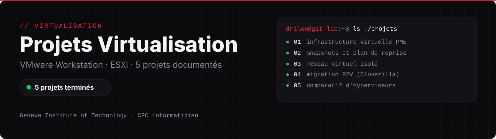

  
  
  
  

# Projets Virtualisation

Documentation de mes projets du module **Virtualisation**, réalisés au **Geneva Institute of Technology** pendant ma première année de CFC d'informaticien. Tout est monté sur mon PC avec VMware Workstation 17 Pro, et sur les serveurs ESXi de l'école pour le comparatif.

**Cours :** Virtualisation — Mettre en place et exploiter une plateforme de virtualisation · **Classe :** E1A

Chaque dossier contient une fiche complète : contexte du projet, étapes réalisées, captures d'écran, incidents rencontrés et résolutions.

## Projets

| Projet | Description |
|---|---|
| [Projet 1 — Infrastructure virtuelle pour une PME](./projet-1-infrastructure-virtuelle-pme) | 3 serveurs (fichiers, impression, applicatif) virtualisés sur un seul hôte, réseau NAT, ressources justifiées par rôle |
| [Projet 2 — Snapshots et plan de reprise](./projet-2-snapshots-plan-de-reprise) | Snapshot avant mise à jour, incident simulé sur nginx, restauration en 16-17 s, plan de reprise (RTO / RPO) |
| [Projet 3 — Réseau virtuel isolé](./projet-3-reseau-virtuel-isole) | Labo isolé (VMnet10) sans accès Internet, VM passerelle avec 5 règles de filtrage |
| [Projet 4 — Migration P2V](./projet-4-migration-p2v) | Migration d'un serveur vers une VM avec Clonezilla, comparaison avant / après, rapport de risques |
| [Projet 5 — Comparatif d'hyperviseurs](./projet-5-comparatif-hyperviseurs) | Workstation et ESXi testés, Proxmox / Hyper-V / VirtualBox évalués, recommandation client |

---

## Voir aussi

- [Projets PPE · IT Essentials](https://github.com/dnhj-06/ppe-projects) : postes de travail Windows
- [Projets Réseau](https://github.com/dnhj-06/projets-reseau) : Cisco IOS dans GNS3
- [Infrastructure VMware en équipe](https://github.com/dnhj-06/cluster-vsphere) : 3 serveurs ESXi, vCenter et Active Directory
- [Mon CV et mes contacts](https://dnhj-06.github.io)
- [← Retour à mon profil](https://github.com/dnhj-06)
