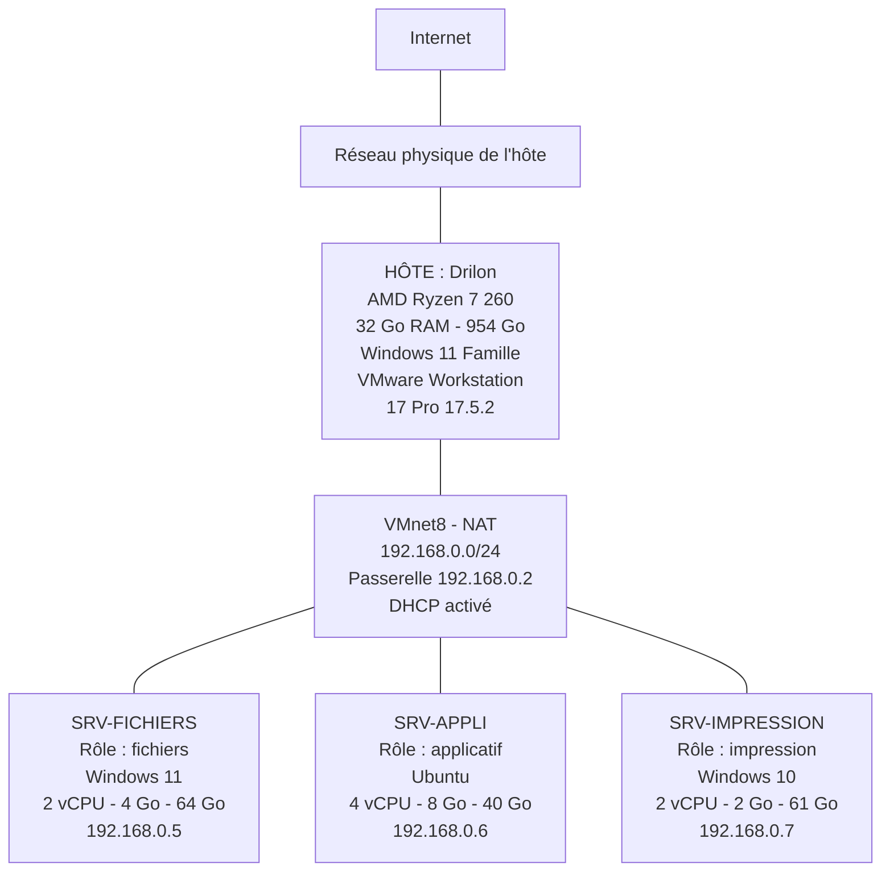

# Projet 1 — Infrastructure virtuelle pour une PME

**Cours :** Virtualisation — Mettre en place et exploiter une plateforme de virtualisation
**Classe :** E1A
**Auteur :** Drilon Nuhija
**Date :** 5 octobre 2026
**Hyperviseur :** VMware Workstation 17 Pro (17.5.2 build-23775571)

---

## Contexte

Une PME de 15 salariés veut remplacer 3 serveurs physiques (fichiers, impression, applicatif) par 3 machines virtuelles, pour réduire ses coûts matériels.

Dans ce projet, les 3 serveurs sont virtualisés sur une seule machine hôte avec VMware Workstation 17 Pro. Chaque rôle a sa propre VM, avec des ressources choisies selon ce que le rôle consomme.

### Résumé de ce qui a été mis en place

| Élément | Valeur |
|---|---|
| Hyperviseur | VMware Workstation 17 Pro, version 17.5.2 build-23775571 |
| Machine hôte | AMD Ryzen 7 260, 32 Go de RAM, 954 Go de stockage, Windows 11 Famille |
| Nombre de VM | 3 |
| Réseau virtuel | VMnet8 (NAT), 192.168.0.0/24, passerelle 192.168.0.2, DHCP activé |
| VM fichiers | SRV-FICHIERS — Windows 11 — 2 vCPU, 4 Go, 64 Go — 192.168.0.5 |
| VM impression | SRV-IMPRESSION — Windows 10 — 2 vCPU, 2 Go, 61 Go — 192.168.0.7 |
| VM applicatif | SRV-APPLI — Ubuntu — 4 vCPU, 8 Go, 40 Go — 192.168.0.6 |
| Communication entre VM | ✅ validée dans les 6 sens (ping) |
| Accès à l'extérieur | ✅ validé (ping vers 8.8.8.8) |

> 📸 Les captures de ce document servent d'illustration. Toutes les valeurs utiles sont aussi écrites en texte, dans les tableaux et les blocs de commandes.

---

## 1. Installer l'hyperviseur sur la machine hôte

### 1.1 Choix de l'hyperviseur

Le sujet laisse le choix entre Proxmox, Hyper-V et VMware selon le matériel disponible. J'ai pris **VMware Workstation 17 Pro** pour deux raisons :

- Je n'ai qu'une seule machine, mon PC, qui doit rester utilisable sous Windows. Proxmox et ESXi s'installent à la place du système, ce n'était donc pas possible.
- Mon PC est sous **Windows 11 Famille**, et Hyper-V n'existe pas sur cette édition.

Workstation est un hyperviseur de **type 2** : il s'installe comme un logiciel par-dessus Windows. Dans une vraie PME, on prendrait un hyperviseur de **type 1** (ESXi, Proxmox, Hyper-V) installé directement sur un serveur, parce qu'il est plus performant et prévu pour tourner en continu. Le principe reste le même : plusieurs VM qui se partagent le matériel d'une seule machine.

### 1.2 Machine hôte

| Composant | Valeur |
|---|---|
| Nom de l'hôte | Drilon |
| Processeur | AMD Ryzen 7 260 w/ Radeon 780M Graphics, 3,80 GHz |
| Mémoire RAM | 32,0 Go (5600 MT/s) |
| Stockage | 954 Go, dont 449 Go utilisés (505 Go libres) |
| Système | Windows 11 Famille 64 bits (build 26200.9457) |

📸 *Capture 01 — Informations système de l'hôte (processeur, RAM, stockage)*


### 1.3 Étapes d'installation

1. **Vérifier la virtualisation matérielle.** Dans le Gestionnaire des tâches → Performance → Processeur, la ligne « Virtualisation » doit indiquer « Activé ». Sinon, il faut activer AMD-V (« SVM Mode ») dans le BIOS.
2. **Télécharger l'installateur** de VMware Workstation Pro 17.5.2 sur le site de l'éditeur (Broadcom).
3. **Lancer l'installateur** en administrateur.
4. **Accepter le contrat de licence.**
5. **Garder le dossier d'installation par défaut.** Laisser cochée l'option qui ajoute les outils en ligne de commande au PATH.
6. **Régler les options d'usage** : vérification des mises à jour au démarrage (au choix), raccourcis sur le Bureau et dans le menu Démarrer.
7. **Cliquer sur Install**, puis sur **Finish** à la fin.
8. **Activer la licence**, puis redémarrer le PC si l'installateur le demande.
9. **Vérifier l'installation** : ouvrir Workstation → Help → About VMware Workstation.

### 1.4 Vérification

| Élément vérifié | Résultat |
|---|---|
| Produit | VMware Workstation 17 Pro ✅ |
| Version | 17.5.2 build-23775571 ✅ |
| Licence | Licensed, sans expiration ✅ |
| Mémoire vue par l'hyperviseur | 32060 Mo ✅ |
| Système hôte détecté | Windows 11 Home, 64-bit (Build 26200.9457) ✅ |

📸 *Capture 02 — Fenêtre « About VMware Workstation 17 Pro » (version et licence)*


L'installation ajoute aussi deux services Windows dont le réseau virtuel dépend. Ils se vérifient dans `services.msc` :

| Service | État | Démarrage |
|---|---|---|
| VMware DHCP Service | En cours d'exécution ✅ | Automatique |
| VMware NAT Service | En cours d'exécution ✅ | Automatique |

📸 *Capture 09 — Services VMware DHCP et NAT en cours d'exécution*


---

## 2. Créer 3 VM avec des rôles distincts

### 2.1 Les 3 VM et leur rôle

| VM | Rôle | Système invité | À quoi elle sert dans la PME |
|---|---|---|---|
| **SRV-FICHIERS** | Serveur de fichiers | Windows 11 (build 10.0.26200.9168) | Dossiers partagés des 15 salariés (partage SMB) |
| **SRV-IMPRESSION** | Serveur d'impression | Windows 10 22H2 (build 10.0.19045.6456) | File d'attente et partage des imprimantes |
| **SRV-APPLI** | Serveur applicatif | Ubuntu 64 bits | Hébergement de l'application métier |

Pourquoi cette répartition :

- **Ubuntu pour l'applicatif** : Linux est le choix habituel pour héberger une application ou un serveur web, et il n'y a pas de licence à payer.
- **Windows pour les fichiers et l'impression** : le partage de fichiers (SMB) et le partage d'imprimantes sont intégrés à Windows, et les postes des salariés sont sous Windows.
- **Une VM par rôle** : si un service plante ou doit redémarrer, les deux autres continuent de tourner.

### 2.2 Étapes de création d'une VM

La procédure est la même pour les 3 VM, seules les valeurs changent (tableau 2.3).

1. Dans Workstation : **Create a New Virtual Machine**.
2. Choisir **Installer disc image file (iso)** et indiquer le fichier ISO du système.
3. Choisir le système invité : *Microsoft Windows* → *Windows 11 x64* ou *Windows 10 x64*, ou *Linux* → *Ubuntu 64-bit*.
4. Donner le **nom** de la VM et son emplacement (`C:\Users\dn040\Documents\Virtual Machines\`).
5. Pour Windows 11 uniquement : définir le mot de passe de **chiffrement**. Windows 11 exige un module TPM, et VMware chiffre la VM pour pouvoir ajouter un TPM virtuel.
6. Indiquer la **taille du disque**.
7. Vérifier le résumé, ajuster le matériel avec **Customize Hardware** si besoin, puis **Finish**.
8. Démarrer la VM et installer le système depuis l'ISO.
9. Une fois le système installé, installer **VMware Tools** (menu VM → Install VMware Tools) pour avoir les pilotes réseau, graphique et souris adaptés à la VM.

Les captures ci-dessous montrent un exemple de création d'une VM Windows 11 avec l'assistant. Les noms et les valeurs retenus pour le projet sont ceux écrits dans le texte et les tableaux.

📸 *Exemple — Lancement de l'assistant (Create a New Virtual Machine)*


📸 *Exemple — Choix du fichier ISO*


📸 *Exemple — Choix du système invité (Windows 11 x64)*


📸 *Exemple — Nom et emplacement de la VM*


📸 *Exemple — Chiffrement pour le TPM virtuel (Windows 11)*


📸 *Exemple — Résumé avant création*


📸 *Exemple — VM créée, matériel virtuel*


### 2.3 Configuration retenue pour chaque VM

| Paramètre | SRV-FICHIERS | SRV-IMPRESSION | SRV-APPLI |
|---|---|---|---|
| Système invité | Windows 11 x64 | Windows 10 x64 | Ubuntu 64-bit |
| Processeurs (vCPU) | 2 | 2 | 4 |
| Mémoire | 4 Go | 2 Go | 8 Go |
| Disque dur | 64 Go (NVMe) | 61 Go (NVMe) | 40 Go (SCSI) |
| TPM virtuel | Présent | Non | Non |
| Carte réseau | VMnet8 (NAT) | VMnet8 (NAT) | VMnet8 (NAT) |

### 2.4 Nommage

Les VM portent un nom qui indique leur rôle. Pour renommer une VM dans Workstation : clic droit sur la VM → **Rename**.

| Nom de la VM | Rôle |
|---|---|
| SRV-FICHIERS | Fichiers |
| SRV-IMPRESSION | Impression |
| SRV-APPLI | Applicatif |

📸 *Capture 03 — Les 3 VM nommées selon leur rôle dans la bibliothèque de Workstation*


---

## 3. Configurer le réseau virtuel

Objectif de la consigne : les VM doivent communiquer **entre elles** et **avec l'extérieur**.

### 3.1 Choix du réseau : NAT sur VMnet8

Les 3 VM sont branchées sur le même réseau virtuel, **VMnet8**, en mode **NAT**.

| Mode | Les VM se voient entre elles | Accès à l'extérieur | Retenu |
|---|---|---|---|
| **NAT (VMnet8)** | Oui | Oui, à travers l'adresse de l'hôte | ✅ |
| Bridged | Oui | Oui, mais dépend du réseau physique | ❌ |
| Host-only | Oui | Non | ❌ |

Le NAT est retenu parce qu'il remplit les deux objectifs sans dépendre du réseau physique : les VM sont dans un sous-réseau à part, et VMware fait la traduction d'adresses pour les faire sortir sur Internet.

### 3.2 Configuration de VMnet8

Elle se vérifie dans **Edit → Virtual Network Editor**.

| Paramètre | Valeur |
|---|---|
| Réseau virtuel | VMnet8 |
| Type | NAT |
| Sous-réseau | 192.168.0.0 |
| Masque | 255.255.255.0 (/24) |
| Passerelle NAT | 192.168.0.2 |
| DHCP | Activé (Enabled) |
| Connexion à l'hôte | Connected |

Les autres réseaux virtuels présents sur l'hôte (VMnet1, VMnet2 et VMnet3, tous en Host-only) ne sont pas utilisés dans ce projet.

📸 *Capture 07 — Virtual Network Editor : VMnet8 en NAT, DHCP activé, sous-réseau 192.168.0.0*


### 3.3 Branchement des VM sur VMnet8

À faire sur chacune des 3 VM :

1. Clic droit sur la VM → **Settings** → **Network Adapter**.
2. Sélectionner **Custom: Specific virtual network** → **VMnet8 (NAT)**. L'option « NAT: Used to share the host's IP address » donne le même résultat.
3. Cocher **Connected** et **Connect at power on**.
4. Valider avec **OK**.

📸 *Capture 08 — Carte réseau d'une VM réglée sur VMnet8 (NAT), « Connected » et « Connect at power on » cochés*


### 3.4 Adressage dans les VM

Les VM sont en adressage automatique : c'est le DHCP de VMnet8 qui leur donne une adresse.

Sur une VM Windows qui avait gardé une adresse fixe, le retour en DHCP se fait en invite de commandes administrateur :

```
netsh interface ip set address name="Ethernet0" source=dhcp
netsh interface ip set dnsservers name="Ethernet0" source=dhcp
ipconfig /renew
```

Adresses obtenues :

| VM | Interface | Adresse IPv4 | Masque | Passerelle | Attribution |
|---|---|---|---|---|---|
| SRV-FICHIERS | Ethernet0 | 192.168.0.5 | 255.255.255.0 | 192.168.0.2 | DHCP |
| SRV-APPLI | ens33 | 192.168.0.6 | 255.255.255.0 (/24) | 192.168.0.2 | DHCP |
| SRV-IMPRESSION | Ethernet0 | 192.168.0.7 | 255.255.255.0 | 192.168.0.2 | DHCP |

**SRV-FICHIERS** — `ipconfig` :

```
Carte Ethernet Ethernet0 :

   Suffixe DNS propre à la connexion. . . : localdomain
   Adresse IPv6 de liaison locale. . . . .: fe80::4d48:5567:fa04:43f7%14
   Adresse IPv4. . . . . . . . . . . . . .: 192.168.0.5
   Masque de sous-réseau. . . . . . . . . : 255.255.255.0
   Passerelle par défaut. . . . . . . . . : 192.168.0.2
```

📸 *Capture 20 — ipconfig sur SRV-FICHIERS*


**SRV-APPLI** — `ip a` :

```
2: ens33: <BROADCAST,MULTICAST,UP,LOWER_UP> mtu 1500 qdisc fq_codel state UP group default qlen 1000
    link/ether 00:0c:29:77:78:37 brd ff:ff:ff:ff:ff:ff
    inet 192.168.0.6/24 brd 192.168.0.255 scope global dynamic noprefixroute ens33
       valid_lft 1553sec preferred_lft 1553sec
    inet6 fe80::20c:29ff:fe77:7837/64 scope link noprefixroute
       valid_lft forever preferred_lft forever
```

📸 *Capture 21 — ip a sur SRV-APPLI*


La passerelle par défaut de SRV-APPLI se vérifie avec `ip route` :

```
default via 192.168.0.2 dev ens33 proto dhcp src 192.168.0.6 metric 20100
192.168.0.0/24 dev ens33 proto kernel scope link src 192.168.0.6 metric 100
```

**SRV-IMPRESSION** — `ipconfig` :

```
Carte Ethernet Ethernet0 :

   Suffixe DNS propre à la connexion. . . : localdomain
   Adresse IPv6 de liaison locale. . . . .: fe80::5fb1:7e89:4083:8795%10
   Adresse IPv4. . . . . . . . . . . . . .: 192.168.0.7
   Masque de sous-réseau. . . . . . . . . : 255.255.255.0
   Passerelle par défaut. . . . . . . . . : 192.168.0.2
```

📸 *Capture 22 — ipconfig sur SRV-IMPRESSION*


### 3.5 Pare-feu Windows : autoriser le ping

Par défaut, le pare-feu Windows bloque les pings entrants. Pour pouvoir tester la communication entre les VM, une règle a été ajoutée sur les deux VM Windows (SRV-FICHIERS et SRV-IMPRESSION), en invite de commandes administrateur :

```
netsh advfirewall firewall add rule name=ping protocol=icmpv4 dir=in action=allow
```

Réponse attendue et obtenue : `Ok.` ✅

Ubuntu répond au ping sans réglage supplémentaire.

📸 *Capture 23 — Règle de pare-feu ajoutée sur SRV-IMPRESSION (réponse « Ok. »)*


---

## 4. Allouer les ressources selon les besoins de chaque rôle

### 4.1 Allocation retenue

| VM | Rôle | vCPU | RAM | Disque | Charge estimée |
|---|---|---|---|---|---|
| SRV-APPLI | Applicatif | 4 | 8 Go | 40 Go | La plus forte en calcul et en mémoire |
| SRV-FICHIERS | Fichiers | 2 | 4 Go | 64 Go | Faible en calcul, forte en stockage |
| SRV-IMPRESSION | Impression | 2 | 2 Go | 61 Go | La plus faible |
| **Total** | | **8** | **14 Go** | **165 Go** | |

### 4.2 Justification par rôle

**SRV-APPLI — 4 vCPU, 8 Go, 40 Go.**
C'est le serveur qui travaille le plus : il exécute l'application et traite les requêtes de plusieurs utilisateurs en même temps. Il reçoit donc le plus de processeur et de mémoire. Il n'a pas besoin de beaucoup de disque, parce qu'il stocke le système et l'application, pas les documents des salariés.

**SRV-FICHIERS — 2 vCPU, 4 Go, 64 Go.**
Servir des fichiers à 15 personnes demande peu de calcul : le travail se résume à lire et écrire sur le disque. La ressource qui compte ici est le stockage, c'est pourquoi cette VM a le plus grand disque des trois. 4 Go de RAM et 2 cœurs correspondent aussi au minimum demandé par Windows 11.

**SRV-IMPRESSION — 2 vCPU, 2 Go, 61 Go.**
C'est le rôle le plus léger : le serveur reçoit les travaux d'impression et les transmet aux imprimantes. Il reçoit donc le moins de mémoire, 2 Go, ce qui est le minimum pour Windows 10 en 64 bits. Le disque de 61 Go contient le système et laisse largement la place pour la file d'attente d'impression.

### 4.3 Cohérence avec la machine hôte

| Ressource | Disponible sur l'hôte | Allouée aux 3 VM | Reste pour l'hôte |
|---|---|---|---|
| RAM | 32 Go | 14 Go (44 %) | 18 Go |
| Stockage | 505 Go libres sur 954 Go | 165 Go au maximum | 340 Go |
| Processeur | AMD Ryzen 7 260 (8 cœurs, 16 threads) | 8 vCPU | — |

- **RAM** : les 3 VM tournent en même temps sans dépasser la mémoire physique. L'hôte garde plus de la moitié de sa RAM pour Windows et pour Workstation, donc il n'y a pas de sur-allocation.
- **Stockage** : même si les 3 disques virtuels étaient pleins, il resterait 340 Go libres sur l'hôte.
- **Processeur** : 8 vCPU au total. Les vCPU sont partagés dans le temps entre les VM, et les 3 serveurs ne sont pas chargés au même moment.

### 4.4 Modifier les ressources d'une VM

1. Éteindre la VM.
2. Clic droit sur la VM → **Settings**.
3. **Memory** : régler la quantité de RAM.
4. **Processors** : régler le nombre de processeurs.
5. Valider avec **OK**, puis redémarrer la VM.

📸 *Capture 04 — Ressources de SRV-APPLI : Memory 8 GB, Processors 4, Hard Disk (SCSI) 40 GB*


📸 *Capture 05 — Ressources de SRV-FICHIERS : Memory 4 GB, Processors 2, Hard Disk (NVMe) 64 GB, Trusted Platform Module Present*


📸 *Capture 06 — Ressources de SRV-IMPRESSION : Memory 2 GB, Processors 2, Hard Disk (NVMe) 61 GB*


---

## 5. Démarrer et valider le fonctionnement des 3 VM

### 5.1 Démarrage

Les 3 VM démarrent et tournent en même temps sur l'hôte.

| VM | État |
|---|---|
| SRV-IMPRESSION | Allumée ✅ |
| SRV-APPLI | Allumée ✅ |
| SRV-FICHIERS | Allumée ✅ |

📸 *Capture 10 — Les 3 VM allumées en même temps (onglets de Workstation)*


### 5.2 Communication entre les VM

Test : un ping depuis chaque VM vers les deux autres, soit 6 tests.

| Depuis | Vers | Adresse | Résultat |
|---|---|---|---|
| SRV-APPLI | SRV-IMPRESSION | 192.168.0.7 | ✅ 4 envoyés, 4 reçus, 0 % de perte |
| SRV-APPLI | SRV-FICHIERS | 192.168.0.5 | ✅ 4 réponses sur 4 |
| SRV-IMPRESSION | SRV-APPLI | 192.168.0.6 | ✅ 4 envoyés, 4 reçus, 0 % de perte |
| SRV-IMPRESSION | SRV-FICHIERS | 192.168.0.5 | ✅ 4 envoyés, 4 reçus, 0 % de perte |
| SRV-FICHIERS | SRV-IMPRESSION | 192.168.0.7 | ✅ 4 envoyés, 4 reçus, 0 % de perte |
| SRV-FICHIERS | SRV-APPLI | 192.168.0.6 | ✅ 4 envoyés, 4 reçus, 0 % de perte |

**Depuis SRV-APPLI (Ubuntu) :**

```
pc02@pc02-VMware-Virtual-Platform:~$ ping -c 4 192.168.0.7
PING 192.168.0.7 (192.168.0.7) 56(84) bytes of data.
64 bytes from 192.168.0.7: icmp_seq=1 ttl=128 time=2.69 ms
64 bytes from 192.168.0.7: icmp_seq=2 ttl=128 time=1.96 ms
64 bytes from 192.168.0.7: icmp_seq=3 ttl=128 time=0.519 ms
64 bytes from 192.168.0.7: icmp_seq=4 ttl=128 time=0.613 ms

--- 192.168.0.7 ping statistics ---
4 packets transmitted, 4 received, 0% packet loss, time 3036ms
rtt min/avg/max/mdev = 0.519/1.443/2.688/0.915 ms
```

```
pc02@pc02-VMware-Virtual-Platform:~$ ping -c 4 192.168.0.5
PING 192.168.0.5 (192.168.0.5) 56(84) bytes of data.
64 bytes from 192.168.0.5: icmp_seq=1 ttl=128 time=1.09 ms
64 bytes from 192.168.0.5: icmp_seq=2 ttl=128 time=0.534 ms
64 bytes from 192.168.0.5: icmp_seq=3 ttl=128 time=0.879 ms
64 bytes from 192.168.0.5: icmp_seq=4 ttl=128 time=0.496 ms
```

📸 *Capture 26 — Ping SRV-APPLI → SRV-IMPRESSION*


📸 *Capture 27 — Ping SRV-APPLI → SRV-FICHIERS*


**Depuis SRV-IMPRESSION (Windows 10) :**

```
C:\Windows\system32>ping 192.168.0.6

Envoi d'une requête 'Ping'  192.168.0.6 avec 32 octets de données :
Réponse de 192.168.0.6 : octets=32 temps=1 ms TTL=64
Réponse de 192.168.0.6 : octets=32 temps<1ms TTL=64
Réponse de 192.168.0.6 : octets=32 temps<1ms TTL=64
Réponse de 192.168.0.6 : octets=32 temps<1ms TTL=64

Statistiques Ping pour 192.168.0.6:
    Paquets : envoyés = 4, reçus = 4, perdus = 0 (perte 0%),
Durée approximative des boucles en millisecondes :
    Minimum = 0ms, Maximum = 1ms, Moyenne = 0ms
```

```
C:\Windows\system32>ping 192.168.0.5

Envoi d'une requête 'Ping'  192.168.0.5 avec 32 octets de données :
Réponse de 192.168.0.5 : octets=32 temps=1 ms TTL=128
Réponse de 192.168.0.5 : octets=32 temps<1ms TTL=128
Réponse de 192.168.0.5 : octets=32 temps<1ms TTL=128
Réponse de 192.168.0.5 : octets=32 temps<1ms TTL=128

Statistiques Ping pour 192.168.0.5:
    Paquets : envoyés = 4, reçus = 4, perdus = 0 (perte 0%),
Durée approximative des boucles en millisecondes :
    Minimum = 0ms, Maximum = 1ms, Moyenne = 0ms
```

📸 *Capture 28 — Ping SRV-IMPRESSION → SRV-APPLI*


📸 *Capture 29 — Ping SRV-IMPRESSION → SRV-FICHIERS*


**Depuis SRV-FICHIERS (Windows 11) :**

```
C:\Windows\System32>ping 192.168.0.7

Envoi d'une requête 'Ping'  192.168.0.7 avec 32 octets de données :
Réponse de 192.168.0.7 : octets=32 temps<1ms TTL=128
Réponse de 192.168.0.7 : octets=32 temps<1ms TTL=128
Réponse de 192.168.0.7 : octets=32 temps<1ms TTL=128
Réponse de 192.168.0.7 : octets=32 temps<1ms TTL=128

Statistiques Ping pour 192.168.0.7:
    Paquets : envoyés = 4, reçus = 4, perdus = 0 (perte 0%),
Durée approximative des boucles en millisecondes :
    Minimum = 0ms, Maximum = 0ms, Moyenne = 0ms
```

```
Envoi d'une requête 'Ping'  192.168.0.6 avec 32 octets de données :
Réponse de 192.168.0.6 : octets=32 temps<1ms TTL=64
Réponse de 192.168.0.6 : octets=32 temps<1ms TTL=64
Réponse de 192.168.0.6 : octets=32 temps<1ms TTL=64
Réponse de 192.168.0.6 : octets=32 temps<1ms TTL=64

Statistiques Ping pour 192.168.0.6:
    Paquets : envoyés = 4, reçus = 4, perdus = 0 (perte 0%),
Durée approximative des boucles en millisecondes :
    Minimum = 0ms, Maximum = 0ms, Moyenne = 0ms
```

📸 *Capture 30 — Ping SRV-FICHIERS → SRV-IMPRESSION*


📸 *Capture 31 — Ping SRV-FICHIERS → SRV-APPLI*


Le TTL confirme quel système répond : 128 pour les deux VM Windows, 64 pour la VM Ubuntu.

### 5.3 Communication avec l'extérieur

Test : un ping vers 8.8.8.8, une adresse publique sur Internet.

| Depuis | Vers | Résultat |
|---|---|---|
| SRV-FICHIERS | 8.8.8.8 | ✅ 4 envoyés, 4 reçus, 0 % de perte |
| SRV-APPLI | 8.8.8.8 | ✅ réponses reçues |
| SRV-IMPRESSION | 8.8.8.8 | ✅ réponses reçues |

**Depuis SRV-FICHIERS :**

```
C:\Windows\System32>ping 8.8.8.8

Envoi d'une requête 'Ping'  8.8.8.8 avec 32 octets de données :
Réponse de 8.8.8.8 : octets=32 temps=452 ms TTL=128
Réponse de 8.8.8.8 : octets=32 temps=535 ms TTL=128
Réponse de 8.8.8.8 : octets=32 temps=286 ms TTL=128
Réponse de 8.8.8.8 : octets=32 temps=176 ms TTL=128

Statistiques Ping pour 8.8.8.8:
    Paquets : envoyés = 4, reçus = 4, perdus = 0 (perte 0%),
Durée approximative des boucles en millisecondes :
    Minimum = 176ms, Maximum = 535ms, Moyenne = 362ms
```

**Depuis SRV-APPLI :**

```
pc02@pc02-VMware-Virtual-Platform:~$ ping 8.8.8.8
PING 8.8.8.8 (8.8.8.8) 56(84) bytes of data.
64 bytes from 8.8.8.8: icmp_seq=1 ttl=128 time=216 ms
64 bytes from 8.8.8.8: icmp_seq=2 ttl=128 time=168 ms
64 bytes from 8.8.8.8: icmp_seq=3 ttl=128 time=131 ms
```

📸 *Capture 24 — Ping SRV-FICHIERS → 8.8.8.8*


📸 *Capture 25 — Ping SRV-APPLI → 8.8.8.8*


### 5.4 Bilan de la validation

| Point de la consigne | Résultat |
|---|---|
| Les 3 VM démarrent | ✅ |
| Les 3 VM tournent en même temps | ✅ |
| Chaque VM a une adresse dans le réseau 192.168.0.0/24 | ✅ |
| Les VM communiquent entre elles (6 pings sur 6) | ✅ |
| Les VM communiquent avec l'extérieur | ✅ |
| Contrôle refait après l'incident 5 : passerelle et extérieur de nouveau joignables | ✅ |

---

## 6. Schéma et fiche d'architecture

### 6.1 Schéma d'architecture (réseau + ressources)



Le même schéma en version texte :

```
                            INTERNET
                               |
                   Réseau physique de l'hôte
                               |
+---------------------------------------------------------------------+
|  HÔTE : Drilon                                                      |
|  AMD Ryzen 7 260 - 32 Go RAM - 954 Go - Windows 11 Famille          |
|  Hyperviseur : VMware Workstation 17 Pro 17.5.2 (type 2)            |
|                                                                     |
|                     Service NAT de VMware                           |
|                               |                                     |
|   ====== VMnet8 (NAT) - 192.168.0.0/24 - DHCP activé ============   |
|   ======           Passerelle : 192.168.0.2          ============   |
|           |                   |                    |                |
|   +---------------+   +---------------+   +----------------+        |
|   | SRV-FICHIERS  |   |   SRV-APPLI   |   | SRV-IMPRESSION |        |
|   | Fichiers      |   |  Applicatif   |   |  Impression    |        |
|   | Windows 11    |   |    Ubuntu     |   |  Windows 10    |        |
|   | 2 vCPU        |   |    4 vCPU     |   |  2 vCPU        |        |
|   | 4 Go RAM      |   |    8 Go RAM   |   |  2 Go RAM      |        |
|   | 64 Go disque  |   |  40 Go disque |   |  61 Go disque  |        |
|   | 192.168.0.5   |   |  192.168.0.6  |   |  192.168.0.7   |        |
|   +---------------+   +---------------+   +----------------+        |
|                                                                     |
|   Total alloué : 8 vCPU - 14 Go RAM sur 32 - 165 Go de disque       |
+---------------------------------------------------------------------+
```

### 6.2 Fiche d'architecture

| Élément | Valeur |
|---|---|
| Besoin | Virtualiser 3 serveurs physiques d'une PME de 15 salariés |
| Hyperviseur | VMware Workstation 17 Pro 17.5.2 build-23775571 (type 2) |
| Hôte | Drilon — AMD Ryzen 7 260, 32 Go RAM, 954 Go, Windows 11 Famille |
| Nombre de VM | 3 (une par rôle) |
| Réseau virtuel | VMnet8, mode NAT |
| Sous-réseau | 192.168.0.0/24 (masque 255.255.255.0) |
| Passerelle | 192.168.0.2 |
| Adressage | DHCP de VMnet8 |
| Sortie vers l'extérieur | NAT à travers la connexion de l'hôte |
| Ressources allouées | 8 vCPU, 14 Go de RAM, 165 Go de disque |
| Ressources restantes sur l'hôte | 18 Go de RAM, 340 Go de stockage |

Plan d'adressage :

| Adresse | Équipement |
|---|---|
| 192.168.0.0/24 | Réseau VMnet8 |
| 192.168.0.2 | Passerelle NAT de VMware |
| 192.168.0.5 | SRV-FICHIERS |
| 192.168.0.6 | SRV-APPLI |
| 192.168.0.7 | SRV-IMPRESSION |

### 6.3 Fiche de configuration — SRV-FICHIERS

| Paramètre | Valeur |
|---|---|
| Nom de la VM | SRV-FICHIERS |
| Rôle | Serveur de fichiers |
| Système invité | Windows 11, 64 bits (build 10.0.26200.9168) |
| Processeurs | 2 vCPU |
| Mémoire | 4 Go |
| Disque dur | 64 Go, contrôleur NVMe |
| TPM virtuel | Présent (VM chiffrée) |
| Carte réseau | VMnet8 (NAT), connectée au démarrage |
| Interface | Ethernet0 |
| Adresse IPv4 | 192.168.0.5 |
| Masque | 255.255.255.0 |
| Passerelle | 192.168.0.2 |
| Attribution de l'adresse | DHCP |
| Pare-feu | Règle « ping » ajoutée (ICMPv4 entrant autorisé) |
| Session utilisée | admin |
| État | Opérationnelle ✅ |

### 6.4 Fiche de configuration — SRV-IMPRESSION

| Paramètre | Valeur |
|---|---|
| Nom de la VM | SRV-IMPRESSION |
| Rôle | Serveur d'impression |
| Système invité | Windows 10 22H2, 64 bits (build 10.0.19045.6456) |
| Processeurs | 2 vCPU |
| Mémoire | 2 Go |
| Disque dur | 61 Go, contrôleur NVMe |
| TPM virtuel | Non |
| Carte réseau | VMnet8 (NAT), connectée au démarrage |
| Interface | Ethernet0 |
| Adresse IPv4 | 192.168.0.7 |
| Masque | 255.255.255.0 |
| Passerelle | 192.168.0.2 |
| Attribution de l'adresse | DHCP |
| Pare-feu | Règle « ping » ajoutée (ICMPv4 entrant autorisé) |
| Session utilisée | PC01_DN |
| État | Opérationnelle ✅ |

### 6.5 Fiche de configuration — SRV-APPLI

| Paramètre | Valeur |
|---|---|
| Nom de la VM | SRV-APPLI |
| Rôle | Serveur applicatif |
| Système invité | Ubuntu, 64 bits |
| Nom d'hôte dans le système | pc02-VMware-Virtual-Platform |
| Processeurs | 4 vCPU |
| Mémoire | 8 Go |
| Disque dur | 40 Go, contrôleur SCSI |
| TPM virtuel | Non |
| Carte réseau | VMnet8 (NAT), connectée au démarrage |
| Interface | ens33 (MAC 00:0c:29:77:78:37) |
| Adresse IPv4 | 192.168.0.6/24 |
| Passerelle | 192.168.0.2 |
| Attribution de l'adresse | DHCP |
| Session utilisée | pc02 |
| État | Opérationnelle ✅ |

### 6.6 Limites et évolutions

Ce projet couvre la plateforme de virtualisation : l'hyperviseur, les 3 VM, leurs ressources et leur réseau. Pour passer en production dans la PME, il faudrait encore :

- **Déployer les services de chaque rôle** : le partage SMB sur SRV-FICHIERS, le partage des imprimantes sur SRV-IMPRESSION et l'application sur SRV-APPLI.
- **Passer sur des systèmes serveur** : Windows 10 et 11 sont des systèmes pour postes de travail. En production, on installerait Windows Server sur les deux VM Windows.
- **Fixer les adresses IP** : les VM reçoivent ici leur adresse par DHCP, donc elle peut changer. Un serveur doit avoir une adresse fixe ou réservée.
- **Séparer les données du système** sur SRV-FICHIERS, avec un deuxième disque virtuel réservé aux dossiers partagés.
- **Utiliser un hyperviseur de type 1** (ESXi, Proxmox ou Hyper-V) sur un serveur dédié, avec des sauvegardes des VM.

---

## Incidents rencontrés

> **Incident 1 — Les VM n'ont pas d'accès réseau au démarrage**
> **Constat :** aucune VM ne joint Internet. Sur SRV-FICHIERS, `ipconfig` renvoie une adresse d'autoconfiguration `169.254.62.101`, masque `255.255.0.0`, sans passerelle.
> **Cause :** les 3 VM n'étaient pas sur le même réseau virtuel. SRV-APPLI et SRV-FICHIERS étaient en Bridged, SRV-IMPRESSION sur VMnet2 (Host-only, sans DHCP). Une adresse en 169.254.x.x veut dire que la VM n'a reçu aucune réponse d'un serveur DHCP.
> **Résolution :** les 3 cartes réseau ont été réglées sur VMnet8 (NAT). ✅

📸 *Capture 11 — ipconfig sur SRV-FICHIERS avec l'adresse 169.254.62.101*


> **Incident 2 — « Média déconnecté » après le passage sur VMnet8**
> **Constat :** sur SRV-IMPRESSION et SRV-FICHIERS, `ipconfig /renew` répond : « Aucune opération ne peut être effectuée sur Ethernet0 lorsque son média est déconnecté. »
> **Cause :** la carte réseau virtuelle n'était pas connectée à la VM. Les vérifications faites avant de trouver : services VMware DHCP et NAT en cours d'exécution ✅, VMnet8 bien en NAT avec le DHCP activé ✅.
> **Résolution :** clic droit sur l'icône de la carte réseau, en bas à droite de la fenêtre de la VM → **Connect**, avec « Connected » et « Connect at power on » cochés dans les paramètres. `ipconfig /renew` ne signale plus d'erreur sur Ethernet0. ✅

📸 *Capture 12 — « Média déconnecté » sur SRV-IMPRESSION*


📸 *Capture 13 — « Média déconnecté » sur SRV-FICHIERS*


📸 *Capture 14 — Carte réseau connectée (le menu propose « Disconnect »)*


📸 *Capture 15 — ipconfig /renew sans erreur sur Ethernet0 après connexion de la carte (SRV-IMPRESSION)*


> **Incident 3 — SRV-IMPRESSION garde une adresse fixe d'un autre réseau**
> **Constat :** carte connectée, mais `ping 8.8.8.8` échoue : « Délai d'attente de la demande dépassé » puis « Réponse de 192.168.10.2 : Impossible de joindre l'hôte de destination ». `ipconfig` affiche `192.168.10.2`, masque `255.255.255.192`, passerelle `192.168.10.1`.
> **Cause :** la VM avait une adresse IP fixe correspondant au réseau VMnet2 (192.168.10.0). Elle ne demandait donc rien au DHCP de VMnet8 et cherchait une passerelle qui n'existe pas sur ce réseau.
> **Résolution :** retour en adressage automatique avec `netsh interface ip set address name="Ethernet0" source=dhcp`, puis `ipconfig /renew`. La VM obtient `192.168.0.7`, passerelle `192.168.0.2`. La même commande a été passée sur SRV-FICHIERS, qui obtient `192.168.0.5`. ✅

📸 *Capture 16 — ipconfig sur SRV-IMPRESSION avec l'adresse fixe 192.168.10.2*


📸 *Capture 17 — Échec du ping vers 8.8.8.8*


📸 *Capture 18 — Adresse 192.168.0.7 obtenue par DHCP*


> **Incident 4 — Erreurs de syntaxe sur les commandes netsh**
> **Constat :** `netsh` répond « Un ou plusieurs paramètres essentiels n'ont pas été entrés » ou « La syntaxe du nom de fichier, de répertoire ou de volume est incorrecte ».
> **Cause :** commande coupée en deux par un retour à la ligne, ou espace manquant entre `name="Ethernet0"` et `source=dhcp`.
> **Résolution :** commande retapée sur une seule ligne, avec un espace entre chaque paramètre. Pour la règle de pare-feu, une version plus courte a été utilisée : `netsh advfirewall firewall add rule name=ping protocol=icmpv4 dir=in action=allow`. ✅

📸 *Capture 19 — Erreur de syntaxe sur la commande netsh (SRV-FICHIERS)*


> **Incident 5 — Perte de l'accès à l'extérieur en cours de projet**
> **Constat :** plus tard dans la journée, `ping 8.8.8.8` échoue sur SRV-IMPRESSION (« Réponse de 192.168.0.7 : Impossible de joindre l'hôte de destination ») et sur SRV-APPLI (« From 192.168.0.6 icmp_seq=1 Destination Host Unreachable », 4 paquets envoyés, 0 reçu, 100 % de perte). Les adresses IP et la route par défaut vers `192.168.0.2` n'ont pas changé.
> **Cause :** la passerelle `192.168.0.2` ne répondait plus. Cette passerelle est fournie par le service NAT de VMware sur l'hôte : le problème venait donc de l'hôte et pas des VM, ce qui explique que deux VM soient touchées en même temps.
> **Résolution :** redémarrage des services « VMware NAT Service » et « VMware DHCP Service » dans `services.msc` sur l'hôte. Les VM joignent de nouveau la passerelle et l'extérieur. ✅

### Tableau récapitulatif des incidents

| N° | VM concernée | Incident | Cause | Résolution | État |
|---|---|---|---|---|---|
| 1 | Les 3 VM | Pas d'accès réseau, adresse 169.254.62.101 | VM sur des réseaux virtuels différents (Bridged et VMnet2) | Les 3 cartes sur VMnet8 (NAT) | ✅ |
| 2 | SRV-IMPRESSION, SRV-FICHIERS | « Média déconnecté » sur Ethernet0 | Carte réseau virtuelle non connectée | Icône réseau → Connect | ✅ |
| 3 | SRV-IMPRESSION | Ping vers 8.8.8.8 en échec, adresse 192.168.10.2 | Adresse IP fixe d'un autre réseau (VMnet2) | Retour en DHCP avec netsh, puis ipconfig /renew | ✅ |
| 4 | SRV-FICHIERS | Erreurs de syntaxe netsh | Commande coupée ou espace manquant | Commande retapée sur une seule ligne | ✅ |
| 5 | SRV-APPLI, SRV-IMPRESSION | Ping vers 8.8.8.8 en échec (Destination Host Unreachable) | Passerelle NAT 192.168.0.2 injoignable (service NAT de VMware sur l'hôte) | Redémarrage des services VMware NAT et DHCP | ✅ |

---

## Livrables

| Livrable attendu | Où le trouver dans ce document | État |
|---|---|---|
| Les 3 VM opérationnelles | Sections 2 et 5 | ✅ |
| Un schéma d'architecture (réseau + ressources) | Section 6.1 | ✅ |
| Une fiche de configuration par VM | Sections 6.3, 6.4 et 6.5 | ✅ |
