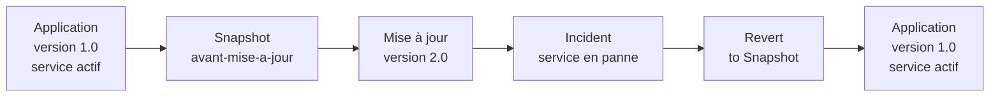

# Projet 2 — Snapshots et plan de reprise d'une VM critique

**Cours :** Virtualisation — Mettre en place et exploiter une plateforme de virtualisation
**Classe :** E1A
**Auteur :** Drilon Nuhija
**Date :** 6 octobre 2026
**Hyperviseur :** VMware Workstation 17 Pro (17.5.2)
**VM concernée :** SRV-APPLI (Ubuntu 26.04)

---

## Contexte

Le serveur applicatif virtualisé d'une entreprise doit pouvoir être restauré rapidement en cas de mauvaise mise à jour ou de panne.

Dans ce projet, le serveur applicatif est la VM **SRV-APPLI**. Une application web simple (nginx) y est installée. Un snapshot est pris avant une mise à jour, la mise à jour casse le service, puis la VM est restaurée à partir du snapshot et le temps de restauration est mesuré.

### Résumé des résultats

| Élément | Résultat |
|---|---|
| VM de test | SRV-APPLI — Ubuntu 26.04 — 4 vCPU, 8 Go de RAM, 40 Go de disque |
| Application | Serveur web nginx 1.28.3, page « Application metier - version 1.0 » |
| Snapshot | `avant-mise-a-jour`, créé le 06.10.2026 à 15:24:32, VM allumée ✅ |
| Modification volontaire | Passage de la page en « version 2.0 » ✅ |
| Incident simulé | Fichier de l'application supprimé + configuration nginx cassée, service en état `failed` ✅ |
| Restauration | Revert to Snapshot, application de retour en « version 1.0 », service `active` ✅ |
| Temps de restauration mesuré | **16 à 17 secondes** |
| Snapshots réguliers | AutoProtect activé : quotidien, 3 snapshots conservés ✅ |
| RTO retenu | 15 minutes |
| RPO retenu | 24 heures (0 pour une mise à jour planifiée) |

> 📸 Les captures de ce document servent d'illustration. Toutes les valeurs utiles sont aussi écrites en texte, dans les tableaux et les blocs de commandes.

### Déroulement du scénario



Le même déroulement en texte :

```
version 1.0 (OK)
   -> SNAPSHOT avant-mise-a-jour
   -> mise à jour 2.0
   -> INCIDENT (service en panne)
   -> RESTAURATION
   -> version 1.0 (OK)
```

---

## Comprendre le mécanisme des snapshots

Un snapshot (instantané) est une photo de l'état d'une VM à un moment précis. VMware enregistre trois choses :

| Ce qui est enregistré | Contenu | Fichier créé par VMware |
|---|---|---|
| L'état du disque | Le disque virtuel est figé. Tout ce qui est écrit ensuite va dans un fichier de différences | fichier `.vmdk` supplémentaire (disque delta) |
| L'état de la mémoire | Le contenu de la RAM, uniquement si la VM est allumée | fichier `.vmem` |
| La configuration | Les réglages de la VM au moment du snapshot | fichier `.vmsn` |

Ce que ça implique :

- **Le snapshot ne copie pas le disque.** Il le fige et écrit les changements à côté. C'est pour ça qu'il est rapide à restaurer : VMware jette le fichier de différences et repart du disque figé.
- **Un snapshot pris VM allumée contient la mémoire.** Au retour, la VM reprend exactement là où elle était, avec ses programmes ouverts et ses services en marche, sans redémarrage. C'est le choix fait ici, pour que nginx soit immédiatement actif après la restauration.
- **Tout ce qui a été fait après le snapshot est perdu à la restauration**, les bonnes modifications comme les mauvaises.
- **Un snapshot n'est pas une sauvegarde.** Il est stocké sur le même disque que la VM et dépend du disque d'origine. Si le disque de l'hôte tombe en panne, la VM et ses snapshots sont perdus ensemble.
- **Un snapshot coûte de la place** : ici au moins 8 Go par snapshot, la taille de la RAM de la VM, plus les changements du disque.

---

## 1. Créer une VM de test avec une application simple installée

### 1.1 La VM de test

La VM utilisée est **SRV-APPLI**, le serveur applicatif de l'infrastructure.

| Paramètre | Valeur |
|---|---|
| Nom de la VM | SRV-APPLI |
| Système invité | Ubuntu 26.04 Desktop, 64 bits |
| Nom d'hôte | pc02-VMware-Virtual-Platform |
| Processeurs | 4 vCPU |
| Mémoire | 8 Go |
| Disque dur | 40 Go (SCSI) |
| Réseau | VMnet8 (NAT) |
| Hyperviseur | VMware Workstation 17 Pro 17.5.2 |

📸 *Ressources de la VM SRV-APPLI : Memory 8 GB, Processors 4, Hard Disk (SCSI) 40 GB*


### 1.2 Création de la VM

Étapes de création d'une VM Ubuntu dans Workstation :

1. **Create a New Virtual Machine**.
2. Choisir le fichier ISO d'Ubuntu (`ubuntu-26.04-desktop-amd64.iso`).
3. VMware reconnaît Ubuntu et propose l'**Easy Install** : saisir le nom complet, le nom d'utilisateur et le mot de passe.
4. Indiquer la taille du disque, vérifier le résumé, puis **Finish**.
5. Suivre l'installateur Ubuntu jusqu'au bureau.

Les captures ci-dessous montrent un exemple de ces étapes. Les valeurs retenues pour le projet sont celles du tableau 1.1.

📸 *Exemple — Lancement de l'assistant de création*


📸 *Exemple — Sélection de l'ISO Ubuntu*


📸 *Exemple — Easy Install*


📸 *Exemple — Bureau Ubuntu une fois l'installation terminée*


### 1.3 Installation de l'application

L'application simple est un **serveur web nginx** qui affiche une page avec le numéro de version de l'application. Ce numéro permet de vérifier d'un coup d'œil dans quel état se trouve le serveur.

Commandes passées dans le terminal de la VM :

```
sudo apt update
sudo apt install -y nginx
sudo systemctl start nginx
echo "<h1>Application metier - version 1.0</h1>" | sudo tee /var/www/html/index.html
sudo apt install -y curl
```

| Commande | Rôle |
|---|---|
| `apt install -y nginx` | Installe le serveur web (version 1.28.3-2ubuntu1.11) |
| `systemctl start nginx` | Démarre le service |
| `echo … \| sudo tee /var/www/html/index.html` | Écrit la page de l'application |
| `apt install -y curl` | Installe l'outil qui sert à tester la page (version 8.18.0-1ubuntu2.7) |

### 1.4 Vérification de l'application

```
pc02@pc02-VMware-Virtual-Platform:~$ curl http://localhost; systemctl is-active nginx
<h1>Application metier - version 1.0</h1>
active
```

| Test | Résultat attendu | Résultat obtenu |
|---|---|---|
| `curl http://localhost` | La page « version 1.0 » | `<h1>Application metier - version 1.0</h1>` ✅ |
| `systemctl is-active nginx` | `active` | `active` ✅ |

📸 *Capture 01 — Application installée : la page répond « version 1.0 » et le service est actif*


---

## 2. Prendre un snapshot avant une modification volontaire

### 2.1 Création du snapshot

Le snapshot est pris **avant** la mise à jour, pendant que l'application fonctionne.

1. Menu **VM → Snapshot → Take Snapshot**.
2. Donner un nom et une description qui disent dans quel état est la VM.
3. Cliquer sur **Take Snapshot** et attendre la fin de l'enregistrement (« Saving state » dans la barre d'état en bas à gauche).

| Paramètre | Valeur |
|---|---|
| Nom | `avant-mise-a-jour` |
| Description | Application en version 1.0, service nginx actif |
| Date de création | 06.10.2026 à 15:24:32 |
| État de la VM | Allumée (la mémoire est incluse dans le snapshot) |
| État de l'application | Version 1.0, service `active` |

Le nom et la description servent à savoir, le jour d'une panne, vers quel état on revient sans avoir à deviner.

### 2.2 Durée de création

La VM étant allumée avec 8 Go de RAM, VMware doit écrire toute la mémoire sur le disque. La progression s'affiche dans la barre d'état :

| Heure | Progression de « Saving state » |
|---|---|
| 15:24:32 | Début du snapshot |
| 15:25 | 16 % |
| 15:31 | 66 % |
| avant 15:37 | Terminé |

La création a donc pris **environ 10 minutes**. Il faut attendre la fin avant de modifier la VM.

📸 *Capture 02 — Snapshot en cours : « Saving state… 16 % » dans la barre d'état de VMware*


📸 *Capture 03 — Snapshot en cours : « Saving state… 66 % »*


### 2.3 Preuve du snapshot

Le snapshot apparaît dans le **Snapshot Manager** (Ctrl+M), juste avant le point « You Are Here » qui représente l'état actuel de la VM.

📸 *Capture 04 — Snapshot Manager : snapshot « avant-mise-a-jour », créé le 06.10.2026 à 15:24:32, avec sa description et la miniature de l'écran*


### 2.4 La modification volontaire

La modification est une mise à jour de l'application, de la version 1.0 à la version 2.0 :

```
echo "<h1>Application metier - version 2.0</h1>" | sudo tee /var/www/html/index.html; curl http://localhost
```

Résultat :

```
<h1>Application metier - version 2.0</h1>
<h1>Application metier - version 2.0</h1>
```

La première ligne est l'écriture du fichier, la seconde est la réponse du serveur web. L'application est bien passée en version 2.0 ✅.

---

## 3. Simuler un incident

### 3.1 Scénario

La mise à jour se passe mal. Deux pannes sont provoquées en même temps, comme après une mauvaise mise à jour :

- **Suppression de fichier** : la page de l'application est effacée.
- **Panne applicative** : une ligne invalide est ajoutée au fichier de configuration de nginx, qui ne peut plus démarrer.

### 3.2 Commandes

```
sudo rm /var/www/html/index.html; echo "erreur de config" | sudo tee -a /etc/nginx/nginx.conf; sudo systemctl restart nginx; systemctl is-active nginx; curl http://localhost
```

| Commande | Effet |
|---|---|
| `sudo rm /var/www/html/index.html` | Supprime la page de l'application |
| `echo "erreur de config" \| sudo tee -a /etc/nginx/nginx.conf` | Ajoute une ligne invalide à la fin de la configuration |
| `sudo systemctl restart nginx` | Redémarre le service, qui relit sa configuration |
| `systemctl is-active nginx` | Affiche l'état du service |
| `curl http://localhost` | Teste la page |

### 3.3 Résultat

```
erreur de config
Job for nginx.service failed because the control process exited with error code.
See "systemctl status nginx.service" and "journalctl -xeu nginx.service" for details.
failed
curl: (7) Failed to connect to localhost port 80 after 1 ms: Could not connect to server
```

| Vérification | Avant l'incident | Après l'incident |
|---|---|---|
| Fichier `/var/www/html/index.html` | Présent | Supprimé ❌ |
| Redémarrage de nginx | Réussi | `Job for nginx.service failed` ❌ |
| `systemctl is-active nginx` | `active` | `failed` ❌ |
| `curl http://localhost` | Page affichée | `Failed to connect to localhost port 80` ❌ |

Le service est totalement indisponible : plus aucun utilisateur ne peut accéder à l'application.

📸 *Capture 05 — La mise à jour en version 2.0, puis l'incident : nginx en échec, état « failed », connexion refusée sur le port 80*


---

## 4. Restaurer la VM à partir du snapshot

### 4.1 Procédure

1. Menu **VM → Snapshot → Revert to Snapshot: avant-mise-a-jour**.
2. VMware prévient que l'état actuel de la VM sera perdu. Confirmer avec **Yes**.
3. Attendre le retour de l'écran de la VM.
4. Vérifier l'application.

### 4.2 Vérification après restauration

```
pc02@pc02-VMware-Virtual-Platform:~$ curl http://localhost; systemctl is-active nginx
<h1>Application metier - version 1.0</h1>
active
```

| Vérification | Pendant l'incident | Après la restauration |
|---|---|---|
| `curl http://localhost` | Connexion refusée ❌ | `<h1>Application metier - version 1.0</h1>` ✅ |
| `systemctl is-active nginx` | `failed` ❌ | `active` ✅ |
| Fichier de l'application | Supprimé ❌ | De nouveau présent ✅ |
| Configuration de nginx | Cassée ❌ | Rétablie ✅ |
| Redémarrage de la VM nécessaire | — | Non ✅ |

La VM est revenue exactement à l'état du snapshot : le terminal affiche de nouveau ce qu'il affichait à 15:24, et le service tourne sans avoir été relancé. La version 2.0 a disparu, ce qui est normal : tout ce qui a été fait après le snapshot est annulé.

📸 *Capture 06 — Restauration réussie : la page répond de nouveau « version 1.0 » et le service est « active »*


---

## 5. Mesurer le temps de restauration

### 5.1 Méthode

La restauration a été faite deux fois : une première fois pour sortir de l'incident (vérifiée en 4.2), puis une seconde fois pour la chronométrer.

| Élément | Valeur |
|---|---|
| Outil | Chronomètre manuel |
| Départ | Clic sur **Yes** dans la fenêtre de confirmation du Revert |
| Arrêt | Retour de l'écran de la VM |
| Nombre de mesures | 1 |

### 5.2 Résultat

| Opération | Durée |
|---|---|
| **Restauration du snapshot (Revert)** | **16 à 17 secondes** |
| Création du snapshot, pour comparaison | environ 10 minutes |

La restauration est environ 35 fois plus rapide que la création. À la création, VMware écrit les 8 Go de mémoire sur le disque. À la restauration, il lui suffit d'abandonner les changements du disque et de recharger l'état enregistré.

### 5.3 Limite de la mesure

Les 16 à 17 secondes mesurent l'opération technique seule. Dans une vraie panne, il faut ajouter le temps pour constater le problème, décider de restaurer et vérifier le service ensuite. C'est ce temps total qui est pris en compte dans le RTO du plan de reprise.

---

## Politique de snapshots réguliers

### Snapshots automatiques : AutoProtect

VMware Workstation peut prendre des snapshots tout seul à intervalle régulier avec **AutoProtect**.

Réglage : Snapshot Manager (Ctrl+M) → **AutoProtect…** → cocher **Enable AutoProtect**.

| Paramètre | Valeur |
|---|---|
| Enable AutoProtect | Activé ✅ |
| AutoProtect interval | Daily (quotidien) |
| Maximum AutoProtect snapshots | 3 |
| Snapshots conservés | 1 par jour, 1 par semaine, 1 par mois |
| Espace disque minimum annoncé par VMware | 24 Go |

Avec ce réglage, VMware garde trois points de retour d'âges différents : le dernier jour, la dernière semaine et le dernier mois. Les 24 Go correspondent à 3 snapshots de 8 Go, la taille de la mémoire de la VM.

📸 *Capture 07 — AutoProtect activé : intervalle Daily, 3 snapshots maximum, 24 Go d'espace disque minimum*


### Règles retenues

| Règle | Détail |
|---|---|
| Snapshot automatique | Tous les jours, par AutoProtect |
| Snapshot manuel | Avant chaque mise à jour ou changement de configuration |
| Nommage | Un nom qui dit pourquoi le snapshot existe, par exemple `avant-mise-a-jour` |
| Description | L'état de l'application au moment du snapshot |
| Conservation | 3 snapshots automatiques au maximum |
| Nettoyage | Supprimer le snapshot manuel une fois la mise à jour validée |
| Limite | Les snapshots ne remplacent pas une sauvegarde sur un autre support |

---

## 6. Plan de reprise — SRV-APPLI

### Périmètre

| Élément | Valeur |
|---|---|
| Service couvert | Application métier (serveur web nginx) |
| Machine | VM SRV-APPLI, sur VMware Workstation 17 Pro |
| Pannes couvertes | Mauvaise mise à jour, fichier supprimé, configuration cassée, service qui ne démarre plus |
| Pannes non couvertes | Panne du disque ou de la machine hôte (voir « Limites ») |

### Objectifs

| Indicateur | Définition | Valeur retenue | Justification |
|---|---|---|---|
| **RTO** | Durée maximale d'interruption acceptée | **15 minutes** | Restauration mesurée à 16-17 s, plus le temps de constater la panne, de décider et de vérifier |
| **RPO** | Perte de données maximale acceptée | **24 heures** | Un snapshot automatique par jour : au pire, on perd une journée de modifications |
| **RPO pour une mise à jour planifiée** | Perte lors d'une mise à jour ratée | **0** | Un snapshot manuel est pris juste avant : seule la mise à jour est perdue |

Décomposition du RTO :

| Étape | Durée prévue |
|---|---|
| Constater la panne | 5 minutes |
| Décider de restaurer | 2 minutes |
| Restaurer le snapshot | 1 minute (mesuré : 16 à 17 secondes) |
| Vérifier le service | 2 minutes |
| Marge | 5 minutes |
| **Total** | **15 minutes** |

### Procédure de reprise

| N° | Action | Commande ou menu | Résultat attendu |
|---|---|---|---|
| 1 | Constater la panne | `systemctl is-active nginx` puis `curl http://localhost` | Service `failed` ou page inaccessible |
| 2 | Choisir le snapshot | Snapshot Manager (Ctrl+M) | Le dernier snapshot où l'application fonctionnait |
| 3 | Restaurer | VM → Snapshot → Revert to Snapshot → **Yes** | Retour de l'écran de la VM en moins d'une minute |
| 4 | Vérifier le service | `curl http://localhost; systemctl is-active nginx` | La page s'affiche et le service est `active` |
| 5 | Prévenir les utilisateurs | — | Service rétabli, modifications depuis le snapshot à refaire |
| 6 | Noter l'incident | — | Cause, heure, snapshot utilisé, durée de l'interruption |

### Prévention

- Prendre un snapshot manuel nommé avant chaque mise à jour.
- Attendre la fin de « Saving state » avant de modifier la VM (environ 10 minutes pour cette VM).
- Laisser AutoProtect activé : 1 snapshot par jour, 3 conservés.
- Tester la restauration régulièrement, pas seulement le jour de la panne.

### Limites

- **Un snapshot n'est pas une sauvegarde.** Il est sur le même disque que la VM. En cas de panne du disque ou de l'hôte, ce plan ne suffit pas : il faut en plus une copie de la VM sur un autre support.
- **La restauration efface tout ce qui a suivi le snapshot**, y compris les données saisies par les utilisateurs entre-temps.
- **Les snapshots prennent de la place** (24 Go au minimum ici) et ralentissent la VM s'ils s'accumulent. Il ne faut pas les garder indéfiniment.

---

## Incidents rencontrés

> **Incident 1 — Commandes déformées au collage**
> **Constat :** les commandes collées dans la VM avec le menu Edit → Paste de VMware arrivent déformées : `szstemctl` au lieu de `systemctl`, `httpö--localhost` au lieu de `http://localhost`. Le terminal répond `sudo: 'szstemctl': command not found`.
> **Cause :** VMware envoie le texte collé comme des frappes sur un clavier américain, alors que la VM est réglée sur un clavier suisse. Les lettres y et z sont inversées et les caractères spéciaux changent.
> **Résolution :** ajout de la disposition « Anglais (États-Unis) » dans Ubuntu (Paramètres → Clavier → Sources de saisie), utilisée pendant les collages. Aucune des commandes déformées n'a modifié la VM. ✅

📸 *Capture 08 — Commandes déformées par la disposition du clavier*


> **Incident 2 — `apt update` se termine en erreur**
> **Constat :** `Erreur : Le dépôt file:/cdrom resolute Release ne contient plus de fichier Release.` L'installation de nginx, enchaînée avec `&&`, ne se lance pas.
> **Cause :** un dépôt « cdrom » est resté dans la configuration d'apt depuis l'installation d'Ubuntu, alors que le disque d'installation n'est plus là. Les dépôts en ligne ont été mis à jour normalement, mais l'erreur a suffi à bloquer la commande suivante.
> **Résolution :** installation lancée séparément avec `sudo apt install -y nginx`. Le dépôt cdrom reste à retirer de la configuration, il n'a pas d'effet sur la suite. ✅

📸 *Capture 09 — Erreur du dépôt cdrom pendant apt update*


> **Incident 3 — nginx ne démarre pas après son installation**
> **Constat :** `policy-rc.d returned 101, not running 'start nginx.service'` puis `invoke-rc.d: policy-rc.d denied execution of start.`
> **Cause :** le système a refusé le démarrage automatique du service à la fin de l'installation. Le service est installé et activé, mais pas lancé.
> **Résolution :** démarrage manuel avec `sudo systemctl start nginx`. `systemctl is-active nginx` répond ensuite `active`. ✅

📸 *Capture 10 — Démarrage automatique de nginx refusé à l'installation*


> **Incident 4 — Lignes collées non exécutées**
> **Constat :** quand plusieurs lignes sont collées d'un coup, seule la première s'exécute. Les suivantes s'affichent dans le terminal mais ne font rien.
> **Cause :** le texte arrive pendant que la première commande (`apt` ou `systemctl`) est encore en cours, et il est absorbé par cette commande.
> **Résolution :** commandes regroupées sur une seule ligne, séparées par des points-virgules. Le terminal lit alors toute la ligne avant de lancer quoi que ce soit. ✅

📸 *Capture 11 — Lignes collées affichées mais non exécutées*


> **Incident 5 — La commande curl est absente**
> **Constat :** `La commande « curl » n'a pas été trouvée, mais peut être installée avec : sudo apt install curl`.
> **Cause :** curl n'est pas installé par défaut sur cette VM Ubuntu.
> **Résolution :** `sudo apt install -y curl`, puis le test de la page a réussi. ✅

📸 *Capture 12 — Commande curl introuvable*


### Tableau récapitulatif des incidents

| N° | Incident | Cause | Résolution | État |
|---|---|---|---|---|
| 1 | Commandes déformées au collage | Disposition de clavier différente entre VMware et la VM | Disposition américaine ajoutée dans Ubuntu | ✅ |
| 2 | `apt update` en erreur | Dépôt cdrom resté dans la configuration d'apt | Installation lancée séparément | ✅ |
| 3 | nginx non démarré après l'installation | Démarrage automatique refusé par le système | `sudo systemctl start nginx` | ✅ |
| 4 | Lignes collées non exécutées | Texte absorbé par la commande en cours | Commandes sur une seule ligne | ✅ |
| 5 | curl absent | Outil non installé par défaut | `sudo apt install -y curl` | ✅ |

---

## Livrables

| Livrable attendu | Où le trouver dans ce document | État |
|---|---|---|
| Preuve du snapshot | Section 2 (captures 02, 03 et 04) | ✅ |
| Preuve de la restauration réussie | Section 4 (capture 06) | ✅ |
| Mesure du temps de restauration | Section 5 : 16 à 17 secondes | ✅ |
| Un plan de reprise d'une page | Section 6 | ✅ |
