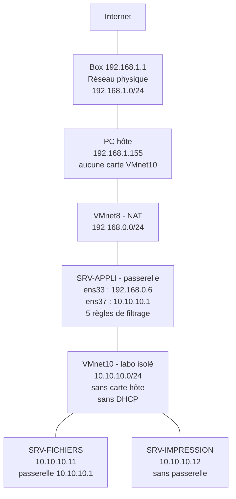

# Projet 3 — Réseau virtuel isolé (labo de test)

**Cours :** Virtualisation — Mettre en place et exploiter une plateforme de virtualisation
**Classe :** E1A
**Auteur :** Drilon Nuhija
**Date :** 6 octobre 2026
**Hyperviseur :** VMware Workstation 17 Pro (17.5.2)

---

## Contexte

Un formateur souhaite disposer d'un labo virtuel isolé du reste du réseau, pour faire tester des configurations risquées aux étudiants sans danger.

Dans ce projet, le labo est un réseau virtuel VMware, **VMnet10**, sur lequel sont branchées deux VM. Ce réseau n'a aucun lien avec Internet, avec le réseau physique ni avec le PC hôte. Une troisième VM sert de passerelle : elle laisse sortir uniquement ce qui est autorisé par ses règles de filtrage.

### Résumé des résultats

| Élément | Résultat |
|---|---|
| Réseau isolé | VMnet10, 10.10.10.0/24, sans carte côté hôte et sans DHCP ✅ |
| VM du labo | SRV-FICHIERS (10.10.10.11) et SRV-IMPRESSION (10.10.10.12) ✅ |
| Accès à Internet depuis le labo | Aucun : 0 réponse sur 4 depuis les deux VM ✅ |
| Accès au réseau physique depuis le labo | Aucun : box et PC hôte injoignables ✅ |
| Accès au labo depuis le PC hôte | Aucun : 0 réponse sur 4 ✅ |
| Connectivité entre les VM du labo | 4 réponses sur 4 ✅ |
| VM passerelle | SRV-APPLI, 2 cartes réseau, routage et traduction d'adresses ✅ |
| Règles de filtrage | 5 règles : DNS et HTTPS autorisés, tout le reste bloqué ✅ |
| Test du filtrage | Port 443 ouvert, port 80 fermé, ping bloqué ✅ |

> 📸 Les captures de ce document servent d'illustration. Toutes les valeurs utiles sont aussi écrites en texte, dans les tableaux et les blocs de commandes.

---

## 1. Créer un commutateur/réseau virtuel de type interne

### 1.1 Choix du réseau

Dans VMware Workstation, un réseau virtuel s'appelle un **VMnet**. Trois types existent :

| Type | Les VM se voient entre elles | Accès au PC hôte | Accès à Internet | Adapté au labo |
|---|---|---|---|---|
| Bridged | Oui | Oui | Oui | ❌ |
| NAT | Oui | Oui | Oui | ❌ |
| Host-only **avec** carte côté hôte | Oui | Oui | Non | ❌ |
| Host-only **sans** carte côté hôte | Oui | Non | Non | ✅ |

Le labo utilise le dernier type. La case **Connect a host virtual adapter to this network** est décochée : le PC hôte n'a alors aucune carte dans ce réseau, il ne peut donc ni l'atteindre ni lui servir de relais. C'est ce réglage qui rend le réseau vraiment isolé.

Un nouveau VMnet a été créé pour ne pas toucher aux réseaux déjà utilisés par d'autres travaux (VMnet2, VMnet3 et VMnet8).

### 1.2 Étapes de création

1. VMware → **Edit → Virtual Network Editor**.
2. **Change Settings** (droits administrateur).
3. **Add Network…** → **VMnet10** → OK.
4. Sélectionner la ligne VMnet10 et régler :
   - **Host-only** : coché ;
   - **Connect a host virtual adapter to this network** : décoché ;
   - **Use local DHCP service to distribute IP address to VMs** : décoché ;
   - **Subnet IP** : `10.10.10.0`, **Subnet mask** : `255.255.255.0`.
5. **Apply**, puis **OK**.

### 1.3 Configuration obtenue

| Paramètre | Valeur |
|---|---|
| Nom | VMnet10 |
| Mode | Host-only |
| Connexion externe | Aucune |
| Carte virtuelle côté hôte | Aucune (case décochée) |
| DHCP de VMware | Désactivé |
| Sous-réseau | 10.10.10.0 |
| Masque | 255.255.255.0 (/24) |

Tous les réseaux virtuels de l'hôte, tels qu'affichés par le Virtual Network Editor :

| Nom | Type | Connexion externe | Connexion à l'hôte | DHCP | Sous-réseau |
|---|---|---|---|---|---|
| VMnet0 | Bridged | Auto-bridging | - | - | - |
| VMnet1 | Host-only | - | Connected | Enabled | 192.168.35.0 |
| VMnet2 | Host-only | - | Connected | - | 192.168.10.0 |
| VMnet3 | Host-only | - | Connected | - | 192.168.10.64 |
| VMnet8 | NAT | NAT | Connected | Enabled | 192.168.0.0 |
| **VMnet10** | **Custom** | **-** | **-** | **-** | **10.10.10.0** |

VMnet10 est le seul réseau dont les colonnes « connexion externe », « connexion à l'hôte » et « DHCP » sont toutes vides.

📸 *Capture 01 — Virtual Network Editor : VMnet10 en Host-only, carte hôte et DHCP décochés, sous-réseau 10.10.10.0*


### 1.4 Vérification côté hôte

La commande `ipconfig` sur le PC hôte liste une carte pour VMnet1, VMnet8, VMnet2 et VMnet3, mais **aucune carte VMnet10**.

| Carte du PC hôte | Adresse IPv4 | Masque | Passerelle |
|---|---|---|---|
| Wi-Fi (réseau physique) | 192.168.1.155 | 255.255.255.0 | 192.168.1.1 |
| VMware Network Adapter VMnet1 | 192.168.35.1 | 255.255.255.0 | - |
| VMware Network Adapter VMnet8 | 192.168.0.1 | 255.255.255.0 | - |
| VMware Network Adapter VMnet2 | 192.168.10.62 | 255.255.255.192 | - |
| VMware Network Adapter VMnet3 | 192.168.10.94 | 255.255.255.224 | - |
| VMware Network Adapter VMnet10 | **absente** ✅ | | |

Ces adresses servent de cibles pour les tests d'isolation de la section 3 : `192.168.1.1` est la box (réseau physique), `192.168.1.155` est le PC hôte et `192.168.0.1` est le réseau NAT de VMware.

📸 *Capture 02 — ipconfig du PC hôte : carte Wi-Fi en 192.168.1.155, passerelle 192.168.1.1*


📸 *Capture 03 — ipconfig du PC hôte : cartes VMnet1, VMnet8, VMnet2 et VMnet3, aucune carte VMnet10*


---

## 2. Connecter au moins 2 VM à ce réseau

### 2.1 Les VM du labo

| VM | Système | Carte réseau | Adresse IPv4 | Masque | Passerelle |
|---|---|---|---|---|---|
| SRV-FICHIERS | Windows 11 | Custom : VMnet10 | 10.10.10.11 | 255.255.255.0 | aucune |
| SRV-IMPRESSION | Windows 10 | Custom : VMnet10 | 10.10.10.12 | 255.255.255.0 | aucune |

Les adresses sont fixes, puisque le réseau n'a pas de DHCP. Aucune passerelle n'est indiquée à ce stade : les VM ne connaissent donc aucun chemin pour sortir de leur réseau.

### 2.2 Branchement sur VMnet10

Pour chaque VM : clic droit → **Settings** → **Network Adapter** → **Custom: Specific virtual network** → **VMnet10**, avec **Connect at power on** coché.

📸 *Capture 04 — SRV-FICHIERS : carte réseau sur « Custom : VMnet10 »*


📸 *Capture 05 — SRV-IMPRESSION : carte réseau sur « Custom : VMnet10 »*


### 2.3 Adressage

Dans chaque VM, en invite de commandes administrateur.

SRV-FICHIERS :

```
netsh interface ip set address name="Ethernet0" static 10.10.10.11 255.255.255.0
```

SRV-IMPRESSION :

```
netsh interface ip set address Ethernet0 static 10.10.10.12 255.255.255.0
```

Vérification avec `ipconfig` sur SRV-FICHIERS :

```
Carte Ethernet Ethernet0 :

   Suffixe DNS propre à la connexion. . . :
   Adresse IPv6 de liaison locale. . . . .: fe80::4d48:5567:fa04:43f7%14
   Adresse IPv4. . . . . . . . . . . . . .: 10.10.10.11
   Masque de sous-réseau. . . . . . . . . : 255.255.255.0
   Passerelle par défaut. . . . . . . . . :
```

Vérification avec `ipconfig` sur SRV-IMPRESSION :

```
Carte Ethernet Ethernet0 :

   Suffixe DNS propre à la connexion. . . : localdomain
   Adresse IPv6 de liaison locale. . . . .: fe80::5fb1:7e89:4083:8795%10
   Adresse IPv4. . . . . . . . . . . . . .: 10.10.10.12
   Masque de sous-réseau. . . . . . . . . : 255.255.255.0
   Passerelle par défaut. . . . . . . . . :
```

📸 *Capture 06 — ipconfig sur SRV-FICHIERS : 10.10.10.11, aucune passerelle*


📸 *Capture 07 — ipconfig sur SRV-IMPRESSION : 10.10.10.12, aucune passerelle*


---

## 3. Vérifier qu'aucune de ces VM n'a accès à Internet ni au réseau physique

### 3.1 Méthode

Depuis chaque VM du labo, un ping est envoyé vers quatre cibles extérieures au labo. Un dernier ping est envoyé dans l'autre sens, du PC hôte vers le labo.

| Cible | Ce qu'elle représente |
|---|---|
| 8.8.8.8 | Internet |
| 192.168.1.1 | La box, donc le réseau physique |
| 192.168.1.155 | Le PC hôte |
| 192.168.0.1 | Le réseau NAT de VMware (VMnet8) |

### 3.2 Résultats depuis SRV-FICHIERS (10.10.10.11)

| Cible | Message | Paquets | Résultat |
|---|---|---|---|
| 8.8.8.8 | Échec de la transmission. Défaillance générale. | 4 envoyés, 0 reçu | ❌ injoignable |
| 192.168.1.1 | Échec de la transmission. Défaillance générale. | 4 envoyés, 0 reçu | ❌ injoignable |
| 192.168.1.155 | Échec de la transmission. Défaillance générale. | 4 envoyés, 0 reçu | ❌ injoignable |
| 192.168.0.1 | Échec de la transmission. Défaillance générale. | 4 envoyés, 0 reçu | ❌ injoignable |

```
C:\Windows\System32>ping 8.8.8.8

Envoi d'une requête 'Ping'  8.8.8.8 avec 32 octets de données :
PING : échec de la transmission. Défaillance générale.
PING : échec de la transmission. Défaillance générale.
PING : échec de la transmission. Défaillance générale.
PING : échec de la transmission. Défaillance générale.

Statistiques Ping pour 8.8.8.8:
    Paquets : envoyés = 4, reçus = 0, perdus = 4 (perte 100%),
```

📸 *Capture 08 — SRV-FICHIERS : ping vers Internet (8.8.8.8) en échec*


📸 *Capture 09 — SRV-FICHIERS : pings vers la box (192.168.1.1) et vers le PC hôte (192.168.1.155) en échec*


📸 *Capture 10 — SRV-FICHIERS : ping vers le réseau NAT de VMware (192.168.0.1) en échec*


### 3.3 Résultats depuis SRV-IMPRESSION (10.10.10.12)

| Cible | Message | Paquets | Résultat |
|---|---|---|---|
| 8.8.8.8 | Échec de la transmission. Défaillance générale. | 4 envoyés, 0 reçu | ❌ injoignable |
| 192.168.1.1 | Échec de la transmission. Défaillance générale. | 4 envoyés, 0 reçu | ❌ injoignable |
| 192.168.1.155 | Échec de la transmission. Défaillance générale. | 4 envoyés, 0 reçu | ❌ injoignable |
| 192.168.0.1 | Échec de la transmission. Défaillance générale. | 4 envoyés, 0 reçu | ❌ injoignable |

📸 *Capture 11 — SRV-IMPRESSION : adresse 10.10.10.12 et ping vers Internet (8.8.8.8) en échec*


📸 *Capture 12 — SRV-IMPRESSION : pings vers la box et vers le PC hôte en échec*


📸 *Capture 13 — SRV-IMPRESSION : ping vers le réseau NAT de VMware en échec*


### 3.4 Résultat depuis le PC hôte vers le labo

```
C:\Users\dn040>ping 10.10.10.11

Envoi d'une requête 'Ping'  10.10.10.11 avec 32 octets de données :
Délai d'attente de la demande dépassé.
Délai d'attente de la demande dépassé.
Délai d'attente de la demande dépassé.
Délai d'attente de la demande dépassé.

Statistiques Ping pour 10.10.10.11:
    Paquets : envoyés = 4, reçus = 0, perdus = 4 (perte 100%),
```

Le PC hôte ne trouve pas le labo : l'isolation fonctionne dans les deux sens ✅.

📸 *Capture 14 — PC hôte : ping vers 10.10.10.11 en échec, 0 reçu sur 4*


### 3.5 Pourquoi le message n'est pas le même

| Message | Signification |
|---|---|
| « Échec de la transmission. Défaillance générale. » | La VM n'a aucune route vers la cible : le paquet ne part même pas |
| « Délai d'attente de la demande dépassé. » | Le paquet part, mais aucune réponse ne revient |

Depuis le labo, les VM n'ont pas de passerelle : elles ne savent pas par où envoyer un paquet qui sort de 10.10.10.0/24. Depuis le PC hôte, le paquet est envoyé vers la box, qui ne connaît pas le réseau 10.10.10.0 et ne répond pas.

### 3.6 Bilan de l'isolation

| Vérification | Résultat |
|---|---|
| Le labo ne joint pas Internet | ✅ 8 pings envoyés, 0 reçu |
| Le labo ne joint pas le réseau physique (box) | ✅ 8 pings envoyés, 0 reçu |
| Le labo ne joint pas le PC hôte | ✅ 8 pings envoyés, 0 reçu |
| Le labo ne joint pas le réseau NAT de VMware | ✅ 8 pings envoyés, 0 reçu |
| Le PC hôte ne joint pas le labo | ✅ 4 pings envoyés, 0 reçu |

---

## 4. Ajouter une VM passerelle avec règles de filtrage

### 4.1 Principe

Le labo est totalement fermé. Pour autoriser un accès contrôlé vers l'extérieur, une VM est placée à cheval sur les deux réseaux. C'est le seul point de passage, et rien ne passe sans une règle qui l'autorise.

| Élément | Valeur |
|---|---|
| VM passerelle | SRV-APPLI (Ubuntu 26.04) |
| Carte 1, côté extérieur | `ens33`, sur VMnet8 (NAT), 192.168.0.6/24 |
| Carte 2, côté labo | `ens37`, sur VMnet10, 10.10.10.1/24 |
| Outil de filtrage | `iptables` |
| Politique | Tout ce qui n'est pas autorisé est bloqué |

### 4.2 Ajout de la deuxième carte réseau

VM éteinte : **Settings** → **Add…** → **Network Adapter** → **Finish**, puis régler le nouveau **Network Adapter 2** sur **Custom : VMnet10**. La première carte reste sur VMnet8.

📸 *Capture 15 — SRV-APPLI : Network Adapter sur VMnet8, Network Adapter 2 sur VMnet10*


État de la VM avant configuration :

```
lo               UNKNOWN        127.0.0.1/8 ::1/128
ens33            UP             192.168.0.6/24 fe80::20c:29ff:fe77:7837/64
ens37            UP
default via 192.168.0.2 dev ens33 proto dhcp src 192.168.0.6 metric 101
192.168.0.0/24 dev ens33 proto kernel scope link src 192.168.0.6 metric 101
État : actif
Par défaut : deny (incoming), allow (outgoing), disabled (routed)
```

La nouvelle carte `ens37` est active mais sans adresse, et le routage est désactivé (`disabled (routed)`) : à ce stade, rien ne traverse la VM.

📸 *Capture 16 — Passerelle avant configuration : ens37 sans adresse, routage désactivé*


### 4.3 Configuration de la passerelle

Adresse de la carte côté labo :

```
sudo nmcli con add type ethernet ifname ens37 con-name labo ipv4.method manual ipv4.addresses 10.10.10.1/24 ipv6.method disabled
sudo nmcli con up labo
```

Activation du routage et de la traduction d'adresses vers l'extérieur :

```
sudo sysctl -w net.ipv4.ip_forward=1
sudo iptables -t nat -A POSTROUTING -s 10.10.10.0/24 -o ens33 -j MASQUERADE
```

Règles de filtrage :

```
sudo iptables -I FORWARD 1 -m conntrack --ctstate ESTABLISHED,RELATED -j ACCEPT
sudo iptables -I FORWARD 2 -i ens37 -d 192.168.0.0/16 -j DROP
sudo iptables -I FORWARD 3 -i ens37 -o ens33 -p udp --dport 53 -j ACCEPT
sudo iptables -I FORWARD 4 -i ens37 -o ens33 -p tcp --dport 443 -j ACCEPT
sudo iptables -I FORWARD 5 -i ens37 -j DROP
```

### 4.4 Les règles de filtrage

La passerelle lit les règles dans l'ordre et applique la première qui correspond.

| N° | Source | Destination | Protocole et port | Action | Rôle |
|---|---|---|---|---|---|
| 1 | Toutes | Toutes | Connexions déjà établies | ACCEPT | Laisse revenir les réponses aux demandes autorisées |
| 2 | Labo (`ens37`) | 192.168.0.0/16 | Tous | DROP | Protège la box, le PC hôte et les autres réseaux privés |
| 3 | Labo (`ens37`) | Extérieur (`ens33`) | UDP 53 | ACCEPT | Autorise la résolution de noms (DNS) |
| 4 | Labo (`ens37`) | Extérieur (`ens33`) | TCP 443 | ACCEPT | Autorise le web sécurisé (HTTPS) |
| 5 | Labo (`ens37`) | Toutes | Tous | DROP | Bloque tout le reste : ping, HTTP, autres ports |

Pourquoi ces choix :

- **La règle 2 passe avant les autorisations.** Sans elle, la règle 4 laisserait le labo ouvrir une connexion HTTPS vers la box ou vers le PC hôte. La plage 192.168.0.0/16 couvre le réseau physique (192.168.1.0/24), le réseau NAT de VMware (192.168.0.0/24) et les autres réseaux virtuels de l'hôte.
- **Seuls le DNS et le HTTPS sortent.** C'est le minimum pour télécharger une mise à jour ou consulter une documentation, sans donner d'accès complet.
- **La règle 5 ferme tout le reste.** Une configuration risquée testée dans le labo ne peut pas scanner ou attaquer un autre réseau.
- **Aucune règle n'autorise l'entrée dans le labo.** Rien ne peut venir de l'extérieur, sauf les réponses aux demandes du labo (règle 1).

### 4.5 Vérification de la configuration

```
ens33            UP             192.168.0.6/24 fe80::20c:29ff:fe77:7837/64
ens37            UP             10.10.10.1/24
net.ipv4.ip_forward = 1
Chain FORWARD (policy DROP 0 packets, 0 bytes)
num   pkts bytes target     prot opt in     out     source       destination
1        0     0 ACCEPT     all  --  *      *       0.0.0.0/0    0.0.0.0/0      ctstate RELATED,ESTABLISHED
2        0     0 DROP       all  --  ens37  *       0.0.0.0/0    192.168.0.0/16
3        0     0 ACCEPT     udp  --  ens37  ens33   0.0.0.0/0    0.0.0.0/0      udp dpt:53
4        0     0 ACCEPT     tcp  --  ens37  ens33   0.0.0.0/0    0.0.0.0/0      tcp dpt:443
5        0     0 DROP       all  --  ens37  *       0.0.0.0/0    0.0.0.0/0
Chain POSTROUTING (policy ACCEPT 9 packets, 743 bytes)
 pkts bytes target     prot opt in     out     source           destination
    0     0 MASQUERADE  all  --  *      ens33   10.10.10.0/24    0.0.0.0/0
```

| Élément vérifié | Résultat |
|---|---|
| `ens37` en 10.10.10.1/24 | ✅ |
| Routage activé (`ip_forward = 1`) | ✅ |
| Politique par défaut de la chaîne FORWARD | ✅ DROP |
| Les 5 règles dans le bon ordre | ✅ |
| Traduction d'adresses pour 10.10.10.0/24 en sortie sur `ens33` | ✅ |

📸 *Capture 17 — Passerelle configurée : ens37 en 10.10.10.1, routage actif, 5 règles de filtrage et règle MASQUERADE*


### 4.6 Raccordement d'une VM du labo à la passerelle

Seule **SRV-FICHIERS** reçoit l'adresse de la passerelle. SRV-IMPRESSION reste sans passerelle, donc totalement isolée : l'accès contrôlé se donne VM par VM.

```
netsh interface ip set address Ethernet0 static 10.10.10.11 255.255.255.0 10.10.10.1
netsh interface ip set dns Ethernet0 static 1.1.1.1
```

Le DNS est un serveur public (1.1.1.1), car le DNS du réseau NAT de VMware se trouve dans une plage bloquée par la règle 2.

📸 *Capture 18 — SRV-FICHIERS : ajout de la passerelle 10.10.10.1 et du DNS 1.1.1.1*


### 4.7 Tests du filtrage depuis SRV-FICHIERS

| Test | Règle concernée | Résultat attendu | Résultat obtenu |
|---|---|---|---|
| `ping 10.10.10.1` | Passerelle elle-même | Réponse | ✅ 4 reçus sur 4 |
| `nslookup example.com` | Règle 3, DNS autorisé | Réponse | ✅ adresses renvoyées par 1.1.1.1 |
| Connexion TCP vers 1.1.1.1 port 443 | Règle 4, HTTPS autorisé | Ouvert | ✅ `TcpTestSucceeded : True` |
| Connexion TCP vers 1.1.1.1 port 80 | Règle 5 | Bloqué | ✅ `TcpTestSucceeded : False` |
| `ping 8.8.8.8` | Règle 5 | Bloqué | ✅ délai d'attente dépassé |
| Ping vers 1.1.1.1 | Règle 5 | Bloqué | ✅ `PingSucceeded : False` |
| `ping 192.168.1.1` (la box) | Règle 2 | Bloqué | ✅ 4 envoyés, 0 reçu |

La passerelle répond :

```
Envoi d'une requête 'Ping'  10.10.10.1 avec 32 octets de données :
Réponse de 10.10.10.1 : octets=32 temps<1ms TTL=64
Réponse de 10.10.10.1 : octets=32 temps<1ms TTL=64
Réponse de 10.10.10.1 : octets=32 temps<1ms TTL=64
Réponse de 10.10.10.1 : octets=32 temps<1ms TTL=64

Statistiques Ping pour 10.10.10.1:
    Paquets : envoyés = 4, reçus = 4, perdus = 0 (perte 0%),
```

📸 *Capture 19 — SRV-FICHIERS : la passerelle 10.10.10.1 répond, 4 reçus sur 4*


Le DNS passe (règle 3) :

```
C:\Windows\System32>nslookup example.com
Serveur :   one.one.one.one
Address:  1.1.1.1

Réponse ne faisant pas autorité :
Nom :    example.com
Addresses:  2606:4700:10::ac42:93f3
          2606:4700:10::6814:179a
          104.20.23.154
          172.66.147.243
```

📸 *Capture 20 — SRV-FICHIERS : résolution de nom réussie à travers la passerelle*


Le ping vers la box est bloqué (règle 2) :

```
Délai d'attente de la demande dépassé.
Délai d'attente de la demande dépassé.
Délai d'attente de la demande dépassé.

Statistiques Ping pour 192.168.1.1:
    Paquets : envoyés = 4, reçus = 0, perdus = 4 (perte 100%),
```

📸 *Capture 21 — SRV-FICHIERS : ping vers la box bloqué par la passerelle, 0 reçu sur 4*


Le port 80 est bloqué (règle 5), le port 443 est ouvert (règle 4) :

```
C:\Windows\System32>powershell Test-NetConnection 1.1.1.1 -Port 80
AVERTISSEMENT : TCP connect to (1.1.1.1 : 80) failed
AVERTISSEMENT : Ping to 1.1.1.1 failed with status: TimedOut

ComputerName           : 1.1.1.1
RemoteAddress          : 1.1.1.1
RemotePort             : 80
InterfaceAlias         : Ethernet0
SourceAddress          : 10.10.10.11
PingSucceeded          : False
PingReplyDetails (RTT) : 0 ms
TcpTestSucceeded       : False
```

```
C:\Windows\System32>powershell Test-NetConnection 1.1.1.1 -Port 443

ComputerName     : 1.1.1.1
RemoteAddress    : 1.1.1.1
RemotePort       : 443
InterfaceAlias   : Ethernet0
SourceAddress    : 10.10.10.11
TcpTestSucceeded : True
```

📸 *Capture 22 — SRV-FICHIERS : port 80 fermé (False), port 443 ouvert (True)*


Le message du ping vers Internet a changé par rapport à la section 3. Avant la passerelle : « échec de la transmission », la VM n'avait aucune route. Avec la passerelle : « délai d'attente dépassé », le paquet part, arrive à la passerelle, et c'est elle qui le bloque.

### 4.8 Compteurs des règles

`iptables` compte les paquets traités par chaque règle. Relevé fait sur la passerelle après une série de tests :

```
Chain FORWARD (policy DROP 0 packets, 0 bytes)
num   pkts bytes target     prot opt in     out     source       destination
1       40 36396 ACCEPT     all  --  *      *       0.0.0.0/0    0.0.0.0/0      ctstate RELATED,ESTABLISHED
2        0     0 DROP       all  --  ens37  *       0.0.0.0/0    192.168.0.0/16
3        1    77 ACCEPT     udp  --  ens37  ens33   0.0.0.0/0    0.0.0.0/0      udp dpt:53
4        2   104 ACCEPT     tcp  --  ens37  ens33   0.0.0.0/0    0.0.0.0/0      tcp dpt:443
5        8   416 DROP       all  --  ens37  *       0.0.0.0/0    0.0.0.0/0
```

| Règle | Paquets | Lecture |
|---|---|---|
| 1 — connexions établies | 40 | Réponses revenues vers le labo |
| 2 — réseaux privés bloqués | 0 | Aucun paquet vers ces réseaux depuis la remise en place des règles |
| 3 — DNS autorisé | 1 | Une demande de résolution de nom est sortie |
| 4 — HTTPS autorisé | 2 | Deux ouvertures de connexion sur le port 443 |
| 5 — tout le reste bloqué | 8 | Huit paquets refusés |

La règle 2 est à 0 sur ce relevé parce que les règles ont dû être remises en place entre-temps (incident 4), ce qui a remis les compteurs à zéro. Son effet est prouvé par le test du ping vers la box, en 4.7.

📸 *Capture 23 — Passerelle : compteurs de paquets par règle*


La passerelle elle-même garde son accès à Internet par sa carte extérieure, puisque les règles ne filtrent que ce qui vient du labo :

```
64 bytes from 8.8.8.8: icmp_seq=60 ttl=128 time=9.21 ms
64 bytes from 8.8.8.8: icmp_seq=61 ttl=128 time=9.94 ms
64 bytes from 8.8.8.8: icmp_seq=62 ttl=128 time=9.41 ms
```

📸 *Capture 24 — Passerelle : ping vers 8.8.8.8 réussi depuis SRV-APPLI*


---

## 5. Tester la connectivité entre les VM du labo

| Depuis | Vers | Résultat |
|---|---|---|
| SRV-FICHIERS (10.10.10.11) | SRV-IMPRESSION (10.10.10.12) | ✅ 4 envoyés, 4 reçus, 0 % de perte |
| SRV-IMPRESSION (10.10.10.12) | SRV-FICHIERS (10.10.10.11) | ✅ réponses reçues, 1 ms ou moins |
| SRV-FICHIERS (10.10.10.11) | Passerelle (10.10.10.1) | ✅ 4 envoyés, 4 reçus, 0 % de perte |

Depuis SRV-FICHIERS :

```
C:\Windows\System32>ping 10.10.10.12

Envoi d'une requête 'Ping'  10.10.10.12 avec 32 octets de données :
Réponse de 10.10.10.12 : octets=32 temps=4 ms TTL=128
Réponse de 10.10.10.12 : octets=32 temps=1 ms TTL=128
Réponse de 10.10.10.12 : octets=32 temps=1 ms TTL=128
Réponse de 10.10.10.12 : octets=32 temps=1 ms TTL=128

Statistiques Ping pour 10.10.10.12:
    Paquets : envoyés = 4, reçus = 4, perdus = 0 (perte 0%),
Durée approximative des boucles en millisecondes :
    Minimum = 1ms, Maximum = 4ms, Moyenne = 1ms
```

Depuis SRV-IMPRESSION :

```
C:\Windows\system32>ping 10.10.10.11

Envoi d'une requête 'Ping'  10.10.10.11 avec 32 octets de données :
Réponse de 10.10.10.11 : octets=32 temps=1 ms TTL=128
Réponse de 10.10.10.11 : octets=32 temps<1ms TTL=128
Réponse de 10.10.10.11 : octets=32 temps<1ms TTL=128
```

Les VM du labo communiquent entre elles dans les deux sens, alors qu'elles ne joignent rien d'autre : le réseau est isolé et fonctionnel ✅.

📸 *Capture 25 — SRV-FICHIERS vers SRV-IMPRESSION : 4 reçus sur 4*


📸 *Capture 26 — SRV-IMPRESSION vers SRV-FICHIERS : réponses reçues*


---

## 6. Documenter le schéma réseau et les règles d'isolation

### 6.1 Schéma réseau annoté



Le même schéma en version texte :

```
                      INTERNET
                         |
              Box 192.168.1.1
        Réseau physique 192.168.1.0/24
                         |
        PC HÔTE 192.168.1.155 (Wi-Fi)
        Carte VMnet8 : 192.168.0.1
        Carte VMnet10 : AUCUNE
                         |
        VMnet8 (NAT) 192.168.0.0/24
                         |
               ens33 : 192.168.0.6
        +-------------------------------+
        |  SRV-APPLI = PASSERELLE       |
        |  Routage + traduction         |
        |  Filtrage : 5 règles          |
        |  Sortie : DNS et HTTPS        |
        |  Tout le reste : bloqué       |
        +-------------------------------+
               ens37 : 10.10.10.1
                         |
  ====== VMnet10 : LABO ISOLÉ 10.10.10.0/24 ======
  ======   sans carte hôte, sans DHCP        ======
            |                         |
   +------------------+     +------------------+
   | SRV-FICHIERS     |     | SRV-IMPRESSION   |
   | Windows 11       |     | Windows 10       |
   | 10.10.10.11      |     | 10.10.10.12      |
   | Passerelle :     |     | Passerelle :     |
   |   10.10.10.1     |     |   aucune         |
   | Accès contrôlé   |     | Isolée           |
   +------------------+     +------------------+
```

### 6.2 Plan d'adressage

| Équipement | Interface | Réseau | Adresse | Passerelle |
|---|---|---|---|---|
| Box | - | Réseau physique | 192.168.1.1 | - |
| PC hôte | Wi-Fi | Réseau physique | 192.168.1.155/24 | 192.168.1.1 |
| PC hôte | VMnet8 | NAT VMware | 192.168.0.1/24 | - |
| SRV-APPLI | ens33 | VMnet8 | 192.168.0.6/24 | 192.168.0.2 |
| SRV-APPLI | ens37 | VMnet10 | 10.10.10.1/24 | - |
| SRV-FICHIERS | Ethernet0 | VMnet10 | 10.10.10.11/24 | 10.10.10.1 |
| SRV-IMPRESSION | Ethernet0 | VMnet10 | 10.10.10.12/24 | aucune |

### 6.3 Règles d'isolation appliquées

| N° | Règle | Où elle est appliquée | Effet |
|---|---|---|---|
| 1 | Réseau dédié au labo | VMnet10 créé pour ce seul usage | Le labo ne partage son réseau avec rien d'autre |
| 2 | Pas de carte côté hôte | Case « Connect a host virtual adapter » décochée | Le PC hôte ne voit pas le labo et ne peut pas lui servir de relais |
| 3 | Pas de connexion externe | VMnet10 en Host-only | Aucun lien avec la carte physique ni avec Internet |
| 4 | Pas de DHCP | Case « Use local DHCP service » décochée | Une VM branchée par erreur ne reçoit aucune adresse |
| 5 | Pas de passerelle par défaut | Adressage fixe sans passerelle sur les VM du labo | Les VM n'ont aucune route pour sortir |
| 6 | Un seul point de passage | SRV-APPLI est la seule VM à deux cartes | Tout ce qui sort du labo passe par les règles de filtrage |
| 7 | Tout est bloqué par défaut | Politique DROP et règle 5 de la passerelle | Seul ce qui est explicitement autorisé passe |
| 8 | Réseaux privés interdits | Règle 2 de la passerelle | Le labo n'atteint ni la box, ni le PC hôte, ni les autres réseaux virtuels |
| 9 | Accès donné VM par VM | Seule SRV-FICHIERS connaît la passerelle | SRV-IMPRESSION reste totalement isolée |

### 6.4 Qui peut joindre quoi

| Depuis | Autre VM du labo | Passerelle | PC hôte et box | Internet en HTTPS et DNS | Internet, autres usages |
|---|---|---|---|---|---|
| SRV-FICHIERS | ✅ | ✅ | ❌ | ✅ | ❌ |
| SRV-IMPRESSION | ✅ | Non testé | ❌ | ❌ | ❌ |
| PC hôte | ❌ | - | - | - | - |

### 6.5 Limites et évolutions

- **Les règles ne survivent pas à un redémarrage de la passerelle.** Le routage, la traduction d'adresses et les règles `iptables` sont réglés en mémoire. Après un redémarrage, il faut les remettre (incident 4). En usage réel, on les enregistrerait pour qu'elles se rechargent au démarrage.
- **Le filtrage se fait par port, pas par site.** Tout le HTTPS est autorisé, quel que soit le site. Pour limiter l'accès à quelques adresses précises, il faudrait un filtrage par destination ou un proxy.
- **Le DNS est autorisé vers n'importe quel serveur.** On pourrait restreindre la règle 3 au seul serveur 1.1.1.1.
- **SRV-IMPRESSION n'a pas été testée à travers la passerelle.** Elle est restée sans passerelle, ce qui correspond au cas « VM totalement isolée ».
- **Les VM du labo sont des Windows 10 et 11**, réutilisées de projets précédents. Le principe est le même avec n'importe quel système.

---

## Incidents rencontrés

> **Incident 1 — Commande netsh déformée au collage**
> **Constat :** sur SRV-IMPRESSION, la commande collée devient `netsh interface ip set address name^äEthernet0ä static …` et Windows répond « La syntaxe du nom de fichier, de répertoire ou de volume est incorrecte ».
> **Cause :** le menu Edit → Paste de VMware envoie le texte comme des frappes sur un clavier américain, alors que la VM est en clavier suisse. Le signe `=` et les guillemets sont remplacés par d'autres caractères.
> **Résolution :** commande réécrite sans guillemets ni signe égal, `netsh interface ip set address Ethernet0 static 10.10.10.12 255.255.255.0`. Elle est passée du premier coup. ✅

📸 *Capture 27 — SRV-IMPRESSION : commande netsh déformée par le collage*


> **Incident 2 — Test-NetConnection non reconnu**
> **Constat :** `'Test'NetConnection' n'est pas reconnu en tant que commande interne ou externe`.
> **Cause :** deux erreurs en même temps. Le collage a remplacé le tiret par une apostrophe, et la commande a été lancée dans l'invite de commandes classique alors que c'est une commande PowerShell.
> **Résolution :** commande tapée à la main, précédée du mot `powershell` : `powershell Test-NetConnection 1.1.1.1 -Port 443`. ✅

📸 *Capture 28 — SRV-FICHIERS : Test-NetConnection refusé dans l'invite de commandes*


> **Incident 3 — Adresse incomplète dans un test**
> **Constat :** `AVERTISSEMENT : Name resolution of 1.1.1. failed`, le test du port 443 ne renvoie aucun résultat.
> **Cause :** faute de frappe, `1.1.1.` au lieu de `1.1.1.1`. Windows a pris cette suite pour un nom à résoudre. Le pare-feu n'y était pour rien.
> **Résolution :** test relancé avec l'adresse complète, résultat `TcpTestSucceeded : True`. ✅

Cet incident est visible sur la capture 21.

> **Incident 4 — Règles de la passerelle perdues après un redémarrage**
> **Constat :** après un redémarrage de SRV-APPLI, la chaîne FORWARD ne contient plus que les lignes par défaut du pare-feu `ufw`. Les 5 règles de filtrage ont disparu.
> **Cause :** les règles `iptables`, le routage et la traduction d'adresses avaient été réglés en mémoire, sans être enregistrés. Un redémarrage remet tout à l'état d'origine. Dans cet état la passerelle ne laisse plus rien passer, ce qui reste sûr pour le labo.
> **Résolution :** les commandes de la section 4.3 ont été relancées. Les 5 règles sont de nouveau en place et les compteurs montrent le trafic filtré (capture 23). ✅

📸 *Capture 29 — Passerelle après redémarrage : les 5 règles ont disparu*


### Tableau récapitulatif des incidents

| N° | VM concernée | Incident | Cause | Résolution | État |
|---|---|---|---|---|---|
| 1 | SRV-IMPRESSION | Commande netsh déformée | Disposition de clavier différente lors du collage | Commande sans guillemets ni signe égal | ✅ |
| 2 | SRV-FICHIERS | Test-NetConnection non reconnu | Tiret déformé et mauvais interpréteur | Commande tapée à la main avec `powershell` devant | ✅ |
| 3 | SRV-FICHIERS | Test du port 443 sans résultat | Adresse incomplète | Test relancé avec 1.1.1.1 | ✅ |
| 4 | SRV-APPLI | Règles de filtrage disparues | Règles non enregistrées, perdues au redémarrage | Commandes de la section 4.3 relancées | ✅ |

---

## Livrables

| Livrable attendu | Où le trouver dans ce document | État |
|---|---|---|
| Le réseau virtuel isolé fonctionnel | Sections 1, 2 et 5 | ✅ |
| Un schéma réseau annoté | Section 6.1 | ✅ |
| Une preuve de l'isolation (tests de connectivité) | Section 3, et section 4.7 pour le filtrage | ✅ |
